# 备备 | AI备婚助手
status: Confirmed

需求来源：飞书文档 [WeddingMaster | 备婚大师](https://my.feishu.cn/wiki/P3Nyw7rYsi8L6QkYgcQcLxKHnwe)。本文按该文档整理可验收需求，不另加文档未要求的能力。2026-10-01 用户确认全文，并确认：1.0 只做 PC 端；建议截止日期与当前阶段按本文规则；批量粘贴只有姓名时分组为「其他」。飞书原稿中的移动端优先与长按排座不进入 1.0。2026-10-02 用户确认技术方案全部按建议：改婚礼日后未手改任务重算、手改任务保留；删有人的桌后人回未排座池；手机号全站唯一；功能页提供退出登录。对应 AC-041 至 AC-044。同日用户确认登录页增加显示密码，对应 AC-045、AC-046。同日用户确认删除婚宴座位表「添加宾客」表单中的备注框，宾客不再填写备注；预算分类备注保留。同日用户确认未排座宾客芯片右侧增加「×」，点击后从名单删除该宾客，对应 AC-047。同日用户确认宾客名单分为「已排座」和「未排座」，拖到桌上后姓名留在「已排座」。同日用户确认左侧名单栏只保留这两个分区；添加宾客改为弹窗填写姓名和分组，页面暂不展示出席、粘贴、搜索和分组筛选。同日用户确认计划书不再单独展示「今日待办」和「逾期任务」，任务只留在阶段分组里，对应 AC-017。此前已确认内容不变。同日用户确认界面产品名称改为「备备」：功能页侧栏顶部大标题，以及登录页标题。注册页原先没有产品名称，标题仍为「注册」。2026-10-02 用户确认新增模块 XiaoBei，见 REQ-012 至 REQ-016、AC-050 至 AC-086。同日确认 Pro 下不能发图，见 AC-087。REQ-001 至 REQ-011 的已确认结论不变。同日用户确认该段写入文字，本文标为 Confirmed。2026-10-03 用户确认婚礼档案增加照片展示，见 REQ-017、AC-090 至 AC-095。建项页仍是五个字段。照片上传后立即保存，不依赖「保存」。同日用户确认「返回」与标题「婚礼档案」同一行、靠右并垂直居中；侧栏「编辑婚礼档案」点一次抽出，再点一次收回。见 AC-090、AC-096。2026-10-03 用户确认新增个人中心：功能页展开的侧栏在「编辑婚礼档案」上方展示头像、注册用户名和今天的日期；未设置头像时显示用户名第一个字符的大写或拼音首字母，例如 Kevin Wang 为 K、王恺博为 W。默认头像为正圆、无边框、玫瑰粉底、白色字。本次不点击、不跳转、不上传头像。见 REQ-018、AC-099 至 AC-102。此前已确认内容不变。同日用户确认点击「退出登录」先出现弹窗，文案为「是否确认退出登录」，选项为「取消」和「确认」。点「取消」仍停留，点「确认」才退出。见 AC-103。2026-10-06 用户确认文档项目名称改为「备备 | AI备婚助手」。页面上的产品名仍是「备备」。

## 用户目标与完整流程

正在准备婚礼、或想先把婚礼规划起来的准新人，独自使用一个网页账号，把备婚拆成可执行任务，把总预算分到分类里，并在临近婚礼时排好婚宴座位。准备过程中可以用备备询问结婚、婚礼和备婚问题。

1.0 只服务账号本人。用户注册并登录后创建一个婚礼项目，系统按婚礼日期从内置模板生成备婚计划。之后用户在四个模块里工作：新建对话、备婚计划书、预算管理本、婚宴座位表。登录后的第一屏仍是备婚计划书。展开的侧栏在「编辑婚礼档案」上方显示当前账号的头像、用户名和今天的日期，这三处不能点击。侧栏第一项是「新建对话」，用来向备备提问；备备不能修改计划书、预算本、座位表或婚礼档案。计划书用来回答「下一步做什么」；预算本只做预分配，不记账；座位表用来录入宾客并排桌。

四条必须走通的主路径：

1. 注册 → 创建婚礼项目 → 看到按模板生成的计划。
2. 使用档案中的总预算 → 把金额分到分类 → 查看并调整分配结果。
3. 建立桌位 → 把宾客排入桌位 → 在页面上查看座位总览。
4. 打开新建对话 → 发送文字或图片 → 看到针对备婚问题的回复。

## 本次范围

### 本次交付

- 可公开访问的简体中文 PC 网页。使用前必须登录。按桌面浏览器交付，1.0 不做移动端适配，不做 App、不做小程序，只服务中国大陆场景。
- 用户名 + 密码注册与登录，注册时绑定手机号（全站唯一），并用短信验证码找回密码。已登录功能页可退出登录；点击后先确认，确认才退出。登录页可在提交前临时显示已输入的密码。
- 每个账号仅一个婚礼项目。计划书、预算本和座位表的数据挂在该项目下，归属账号本人。XiaoBei 的对话挂在账号下，不挂在婚礼项目上。婚礼档案可另存 1 张新人合影，只在档案页展示。
- 备婚计划书、预算管理本、婚宴座位表。1.0 这三个模块各自维护数据，不做跨模块联动。
- 备备对话：备婚问答。侧栏入口为「新建对话」。1.0 由平台统一接入 Deepseek，用户不能填写密钥，也不能更换为其他公司的模型。只做对话，不代用户修改其他模块。
- 个人中心：功能页展开的侧栏在历史区域和「编辑婚礼档案」之间显示圆形头像、注册用户名和今天的日期。未设置头像时显示首字母。本次不能点击，也不能上传头像。
- 1.0 完全免费，不做商业化。

### 非目标

- 夫妻或伴侣协作、邀请成员、管理员 / 写作者权限、多人记账。
- 男方 / 女方视角，以及成员分工标签。
- B 端能力（婚礼策划师、婚庆公司）。
- 账号注销入口。
- 一个账号多个婚礼项目。数据导出、云导出、打印视图、文件导出。
- 计划书的时间轴 / 日历视图、附件、花费关联、子任务、任务指派、用户自定义模板保存。
- 邮件、短信、浏览器推送提醒。
- 实际记账、付款记录、商家报价、比价、定金跟踪。
- 宾客名单文件上传解析；座位表智能排座建议。
- 婚礼档案「总人数」与座位表宾客名单互相同步。
- 在创建婚礼项目时上传照片。档案照片不进入 XiaoBei，也不出现在计划书、预算本和座位表。不做公开相册，每个项目 1 张。
- 模块之间的数据自动关联。
- 移动端布局、触控手势和移动端排座。包括长按宾客芯片弹出桌列表、双指缩放。1.0 只保证桌面浏览器中的鼠标与键盘操作。
- XiaoBei 的语音、视频、录音、通用附件、联网搜索、生图、PPT、写作、解题、深度研究、数据分析、技能、工作空间、模式胶囊，以及 @ 添加上下文。扩展名为 .md 的 Markdown 不在此列，见 AC-104。
- XiaoBei 代用户创建或修改任务、预算、宾客、座位和婚礼档案。
- 对话分享链接、导出对话、打印对话、清空该账号的全部 XiaoBei 记录、两人共用同一段对话。
- 在 XiaoBei 页面修改密码、手机号或婚礼档案。
- 个人中心独立页面，以及上传、更换头像、修改用户名，或从这里进入其他页面。
- 向用户展示 Deepseek 密钥、思考过程，或每人的条数和轮数上限。

### 影响交付的约束

- 产品定位是负责人本人真实备婚的自用工具：1.0 功能需要能真实跑通并长期使用。站点可公开访问，面向更多用户开放留到 2.0。
- 扩展位只保留概念，1.0 不实现：多婚礼项目、云导出、协作人数上限。
- 1.0 终端以 2026-10-01 的确认为准：只做 PC 端桌面浏览器。飞书原稿里的「移动端优先」和移动端排座不在本次范围。

## 需求与验收

### REQ-001 注册账号
- 用户结果与主流程：未注册用户提交用户名、密码和手机号后获得账号，并立刻进入创建婚礼项目。
- 业务规则、权限、数据归属与状态（适用时）：手机号在注册时强制绑定，作为找回密码通道，且全站唯一。密码至少 8 位，且同时包含英文大写字母、小写字母和数字。1.0 不提供账号注销。
- 业务前置条件：用户尚未拥有账号。
- AC-001：未注册访客打开注册 → 提交符合规则的用户名、密码和手机号 → 账号创建成功，并进入创建婚礼项目引导；验证方式：用新用户名走完注册并看到建项引导。
- AC-002：密码少于 8 位，或缺少大写、小写、数字中的任一类，或未填手机号 → 提交被拒绝，账号不创建，并看到明确的失败原因；验证方式：分别用不合规密码和空手机号提交。
- AC-043：已有账号绑定某手机号后，另一访客用同一手机号注册 → 提交被拒绝，新账号不创建，并看到手机号已被注册的说明；验证方式：用已占用手机号再走一遍注册。

### REQ-002 登录与登录态
- 用户结果与主流程：已注册用户用用户名和密码登录。密码框默认以圆点隐藏已输入内容。密码框右侧有显示控制：点击后在本页看到明文，再点一次恢复圆点。该切换不修改已输入的字符，也不代替点击「登录」。勾选「记住用户名和密码」后，30 天内再次打开站点可免输入进入产品；未勾选时，登录态随本次会话结束失效。功能页提供「退出登录」。点击后出现弹窗「是否确认退出登录」，选项为「取消」和「确认」。点「取消」关闭弹窗，仍停在当前功能页。点「确认」后退出，需重新登录才能进入产品。同一账号允许多端同时在线。
- 业务规则、权限、数据归属与状态（适用时）：1.0 只支持用户名 + 密码登录，不支持手机验证码登录。未登录不能使用 XiaoBei、备婚计划书、预算管理本和婚宴座位表。退出登录会清除当前浏览器的登录态，包括 30 天记住选项产生的登录态。多端同时在线指多个 PC 浏览器会话，不包含移动端客户端。退出本端不影响其他浏览器中的登录。显示密码只改变登录页密码框的可见性，不改变随后提交的密码。每次打开登录页时密码框恢复为隐藏。注册页和找回密码页的密码框保持隐藏，本次不提供该控制。
- 业务前置条件：账号已注册。
- AC-003：已注册用户在登录页输入正确的用户名和密码，不勾选记住选项 → 进入备婚计划书；关闭会话后再次打开需要重新登录；验证方式：登录后结束会话再访问功能页。
- AC-004：登录时勾选记住用户名和密码 → 30 天内再次打开站点无需输入即可进入产品；验证方式：勾选后重新打开站点，确认免输入进入；超过 30 天的失效可按时间条件抽查。
- AC-005：用户名或密码错误 → 停留在登录页并看到失败提示，不进入功能模块；验证方式：用错误密码提交。
- AC-006：同一账号在两个浏览器中先后登录 → 两端都保持可用；验证方式：两端分别打开备婚计划书。
- AC-044：已登录用户在功能页点击退出登录，并在弹窗中点「确认」→ 回到登录页；再次访问备婚计划书需要重新登录；即使登录时勾选了记住选项，这 30 天登录态也被清除；验证方式：勾选记住后登录，点击退出并确认，再打开计划书入口。
- AC-103：已登录用户在功能页点击退出登录 → 出现弹窗，文案为「是否确认退出登录」，选项为「取消」和「确认」。点「取消」后弹窗关闭，仍停在当前功能页，登录态不变；验证方式：登录后点退出，再点取消，确认地址和页面未变，刷新后仍无需重新登录。
- AC-045：登录页密码框已有内容且显示为圆点 → 点击密码框右侧的显示控制 → 同一串字符以明文出现，页面仍停在登录页，登录尚未发生；验证方式：输入一串已知字符后点击显示，对照明文。
- AC-046：密码处于明文时再点一次该控制 → 恢复为圆点，框内字符不变；再用该密码点击登录，结果与一直隐藏时相同；验证方式：显示后再隐藏，分别用正确密码和错误密码提交。

### REQ-003 找回密码
- 用户结果与主流程：用户通过注册时绑定的手机号接收短信验证码，设置新密码后可以用新密码登录。
- 业务规则、权限、数据归属与状态（适用时）：新密码遵守 REQ-001 的密码规则。验证码只用于重置密码，不作为登录方式。验证码不在网页上展示。开发环境默认不向手机真实发短信；生产环境向绑定手机号发送。缺少短信配置时，注册、登录和四个功能模块仍可用。
- 业务前置条件：账号已绑定手机号。
- AC-007：用户发起找回密码，向绑定手机号提交正确验证码，并设置符合规则的新密码 → 旧密码失效，新密码可以登录；验证方式：重置后分别用旧密码和新密码登录。
- AC-008：验证码错误，或新密码不符合规则 → 密码不变，并看到失败原因；验证方式：提交错误验证码和不合规新密码。

### REQ-004 创建并维护唯一婚礼项目
- 用户结果与主流程：注册成功后进入建项引导。用户填写开始备婚日期、婚礼日期、城市、总预算、总人数，创建自己唯一的婚礼项目。之后可以修改这些档案字段。婚礼档案在这五项之上还有新郎昵称、新娘昵称、新郎生日、新娘生日。第一排是新郎昵称和新郎生日，第二排是新娘昵称和新娘生日，生日用日历选择。总人数下方还有「其他婚礼偏好」，输入框预留四行文字。这些项创建项目时不填。
- 业务规则、权限、数据归属与状态（适用时）：1.0 每个账号只能有 1 个婚礼项目。计划书、预算本和座位表的数据挂在该项目下，归属账号本人。XiaoBei 的对话挂在账号下。总人数只是档案记录，不与座位表宾客人数同步。总预算是预算管理本的唯一起点。用户修改婚礼日期后，倒计时和当前阶段按新年礼日计算；尚未被用户改过截止日期的任务按 REQ-005 的回推规则重算；用户已经改过截止日期的任务保持原日期。
- 业务前置条件：用户已登录，且尚未创建婚礼项目时必须先完成建项才能使用四个模块。
- AC-009：刚注册的用户填写全部档案字段并提交 → 生成 1 个婚礼项目，并进入备婚计划书；验证方式：提交后看到计划书，且档案中能看到所填字段。
- AC-010：已有婚礼项目的账号再次尝试创建 → 不能得到第二个项目，并看到已有项目的限制说明；验证方式：从已有项目账号触发创建。
- AC-011：用户修改档案中的总预算 → 预算管理本顶部的总预算随之变为新值；修改总人数 → 座位表宾客总数不变；验证方式：分别改这两个字段后查看两个模块。
- AC-041：婚礼日为 2027-10-20 的项目中，用户把某一条备婚启动任务的截止日期改成 2027-05-01，再把婚礼日改为 2027-11-20 → 该条仍为 2027-05-01；其余未改过截止日期的备婚启动任务变为 2027-05-20；倒计时和当前阶段按 2027-11-20 计算；验证方式：改日期前后对照这三类结果。
- AC-097：打开婚礼档案 → 左栏最上方第一排是新郎昵称、新郎生日，第二排是新娘昵称、新娘生日，生日用日历选择。下面仍是开始备婚日期、婚礼日期、城市、总预算、总人数。这四项可以留空并保存。填写后保存，再次打开仍是所填内容。创建婚礼项目页没有这四项。计划书、预算本、座位表和 XiaoBei 不显示这四项；验证方式：在档案填写并保存后刷新，再打开建项页和四个模块。
- AC-098：打开婚礼档案 → 总人数下方是「其他婚礼偏好」，输入框预留四行文字高度。可以留空并保存。写入多行文字后保存，再次打开仍是所填内容，换行还在。整份档案留在一屏内，左栏不出现滚动条；文字超过四行时只在这个输入框里滚动。创建婚礼项目页没有此项。计划书、预算本、座位表和 XiaoBei 不显示；验证方式：填写并保存后刷新，再打开建项页和四个模块，并查看档案是否超出一屏。

### REQ-005 备婚计划书
- 用户结果与主流程：创建项目时，系统按内置模板和婚礼日期生成任务清单，每项任务带建议截止日期。用户可以增删改任务，也可以新增阶段、编辑阶段名称、删除阶段，以及按住阶段标题调整阶段顺序。计划默认按 5 个阶段分组，支持折叠。当前所处阶段默认展开，留在列表中的原位置，不自动排到最前。
- 业务规则、权限、数据归属与状态（适用时）：
  - 任务字段为：任务名称、所属阶段、截止日期、状态（未开始 / 进行中 / 已完成 / 已超期）、备注。备注可空。列表最前有一枚直径 5px 的圆点，其后从左到右展示事项名称、「截止日期」加日期、备注、状态、编辑和删除。没有备注时该列留空。所属阶段不在这一行展示。点「编辑」只改任务名称。点日期标签直接打开日期选择器，标签右侧有下拉箭头；改过的日期在之后修改婚礼日时不重算。删除前弹出「您是否确认删除？」，取消不删除，确认后才删除。
  - 在任务行的名称、备注或空白处按住超过 0.5 秒后，可以拖动该任务。未满 0.5 秒就松手，或按住后移动超过很小一段距离再松手，任务留在原地。满 0.5 秒后，任务跟着指针移动，可以放到同一阶段或其他阶段的任意一条之前、之后，或该阶段的末尾。拖到还折叠着的阶段时，该阶段展开，以便选择位置。松手后只改变所属阶段和阶段内顺序，名称、状态、截止日期和备注都不变。按住状态下拉、日期、编辑或删除不会开始拖动。刷新后顺序仍在。
  - 1.0 只有按阶段分组的列表，没有时间轴或日历。
  - 模板由产品维护，用户不能把改过的清单保存成新模板。
  - 同一阶段的全部默认任务共用一个建议截止日期，按日历月或日历日从婚礼日回推：备婚启动为婚礼日前 6 个月，中期筹备为前 3 个月，婚前冲刺为前 1 个月，婚礼月为前 7 天，婚礼周为婚礼日当天。回推月份时保持日号；目标月没有该日时，落到该月最后一天。用户之后可以改单条截止日期。用户新增的任务、以及用户改过截止日期的任务，在之后修改婚礼日期时不重算；其余未改过截止日期的任务按新年礼日重算。详见 AC-041。
  - 当前阶段按下面顺序判定，先命中者生效。婚礼日已过：不自动展开任何阶段，全部阶段可折叠。今天在婚礼日前 0 至 7 天（含婚礼当天）：婚礼周。今天与婚礼日在同一个自然月，且距婚礼日多于 7 天：婚礼月。距婚礼日多于 7 天且不超过 3 个日历月，又不满足婚礼月：婚前冲刺。距婚礼日多于 3 个日历月且不超过 6 个日历月：中期筹备。距婚礼日多于 6 个日历月（含超过 12 个月）：备婚启动。命中的阶段只决定默认展开哪一组，不改变列表顺序。
  - 阶段列表按用户保存的顺序展示。标题行从左到右是序号标签、阶段名称、编辑、删除、下拉箭头。序号写成 STAGE-01 起，单独放在白底粉字、字重 700 的标签里，和后面的【名称】分开，按当时的上下顺序自动重写，不能手改。编辑只改【】里的名称，名称为空时不保存。展板下方、第一组阶段上方的右上角有粉底白字的「新增阶段」，位置与预算页「新增预算」相同，新阶段加在最后，名称为「新阶段」，立刻展开并进入编辑。删除前弹出「您是否确认删除？」，取消则阶段还在；确认后该阶段和其中的任务一起删除。在标题文字、序号标签或标题行空白处按住超过 0.5 秒，可以拖动整组阶段，样式与任务拖动相同；未满 0.5 秒松手只展开或收起。按住编辑、删除、下拉箭头或「新增任务」不会拖动阶段。松手后这一组和它的任务一起换位置，序号跟着新顺序重写。五个默认阶段同样可以改名、删除和拖动。刷新后顺序和名称仍在。
  - 阶段与默认任务如下。下表是新建时的默认标题，字号 16px。序号随顺序变化，【】内的名称可以改。

| 阶段 | 默认任务 |
| --- | --- |
| STAGE-01【备婚启动期】 | 确定婚礼日期；选择婚礼策划师；制定婚礼预算及预算划分；估算宾客人数；选择婚礼场地；预定婚礼场地；选择四大专业人员（摄影、摄像、主持、化妆）；搜集婚礼灵感；测量婚礼场地 |
| STAGE-02【正式筹备期】 | 制定婚宴设计初稿；确定婚宴设计终稿；租赁 / 定做新娘婚纱；租赁 / 定制新郎西装；确定伴郎 / 伴娘服饰；购买 / 定制父母服饰；拍摄婚纱照；购买婚礼对戒；甜品方案确定 |
| STAGE-03【婚前冲刺期】 | 设计婚礼邀请函；发邀请函正式邀请宾客；购买 / 定制婚礼纸品（誓言本 / 桌号牌 / 宾客名牌 / 菜单 / 感谢卡等）；购买喜糖盒；购买 / 定制伴手礼；购买新人物品（签到本、签到笔、新娘房装饰物品、堵门道具、烟酒茶糖等）；确定婚宴菜单和试菜 |
| STAGE-04【婚礼月】 | 见主持人确定婚礼流程；选择婚礼暖场 / 仪式 / 用餐音乐；与摄影师沟通拍摄方案；与摄像师沟通拍摄方案；确定婚礼当日流程；写誓词；确定宾客名单；安排宾客交通 / 住宿；安排宾客座位 |
| STAGE-05【婚礼周】 | 新娘试妆；新娘做指甲 / 染发；新郎修剪头发；确定现场工作人员的工作职责；取婚纱礼服西装；运送新人方物料到酒店；彩排 |

- 业务前置条件：当前账号已有婚礼项目。
- AC-012：用户首次创建婚礼日期为 2027-10-20 的项目 → 计划书出现上表 5 个阶段、共 41 项任务，初始状态为未开始；备婚启动任务截止日期为 2027-04-20，中期筹备为 2027-07-20，婚前冲刺为 2027-09-20，婚礼月为 2027-10-13，婚礼周为 2027-10-20；验证方式：对照上表核对名称、阶段和这五个日期。另用婚礼日 2027-03-31 核对月份回推：中期筹备为 2026-12-31，婚前冲刺为 2027-02-28。
- AC-013：每个展开的阶段标题下有「新增任务」，页面顶部没有统一的新增按钮。点某一阶段的该按钮 → 在该阶段最前出现一项「新任务」并可改名称，所属阶段就是这一阶段；点「编辑」只改名称、点日期标签改截止日期、将状态改为进行中 → 刷新后仍保持这些改动，其余未改任务不变。行内控件不能改所属阶段。点「删除」先看到「您是否确认删除？」；点「取消」该任务仍在；点「确认」后该任务消失，刷新后仍不在；验证方式：改完后重新进入计划书核对。
- AC-048：在任务名称上按住不到 0.5 秒后松手 → 该任务仍在原阶段原位置。按住超过 0.5 秒后，把该任务拖到另一阶段的第二条之前松手 → 它出现在那个阶段的该位置，名称、状态、截止日期不变，目标阶段若原本折叠则已展开；刷新后仍在该位置。同一阶段内拖到另一条之后，顺序跟着变。按住状态下拉、日期、编辑或删除超过 0.5 秒，任务不被拖走。验证方式：在计划书上完成这四次按住。
- AC-014：用户把一项任务标为已完成 → 该项状态变为已完成，总体进度的已完成数加 1；验证方式：看该项状态和顶部进度条。
- AC-015：进入计划书时，阶段按用户保存的顺序排列，不把当前阶段移到最前。命中的当前阶段默认展开，其他阶段默认折叠。以婚礼日 2027-10-20、且阶段仍是默认顺序时验证：今天为 2026-01-01 时展开备婚启动，它仍是第一组；2027-04-20 展开正式筹备期，它仍排在第二；2027-07-20 展开婚前冲刺期；2027-10-01 展开婚礼月；2027-10-13 展开婚礼周；2027-10-21 不自动展开任何阶段。验证方式：固定这六个「今天」分别打开计划书，并核对顺序没有把展开的那一组排到最前。
- AC-089：阶段标题行从左到右是白底粉字、字重 700 的 STAGE-0N 标签、【名称】、编辑、删除和一只下拉箭头，没有「展开」「折叠」文字按钮。点标题、序号标签或箭头可以展开、收起。点「编辑」后只改【】里的名称，序号不进输入框；名称为空时不保存。与「新增预算」同一位置的粉底白字按钮点「新增阶段」→ 最后出现「新阶段」，已展开，并处在编辑中。点「删除」先看到「您是否确认删除？」；点「取消」阶段和任务都还在；点「确认」后该阶段消失，其中的任务也消失，后面的序号前移。在标题上按住不到 0.5 秒后松手 → 只切换展开，顺序不变。按住超过 0.5 秒后把该阶段拖到另一组之前松手 → 整组和其中任务一起到新位置，任务名称、状态、截止日期不变，序号按新顺序重写；刷新后仍在。按住编辑、删除、箭头或「新增任务」超过 0.5 秒，阶段不被拖走。五个默认阶段同样可以改名、删除和拖动。验证方式：在计划书上完成新增、改名、取消删除、确认删除和这几次按住。

### REQ-006 计划书落地信息
- 用户结果与主流程：登录后默认进入备婚计划书。页面顶部最前一格显示婚礼日期，排版与倒计时相同：上方为「婚礼日期」，下方为年/月/日，月和日不补零，例如上方「婚礼日期」、下方「2026/9/12」。其后是距婚礼日的倒计时天数，以及已完成数 / 总任务数、进行中数 / 总任务数。日期取档案中的婚礼日；修改婚礼日后，这一格与倒计时一起换成新日期。任务只出现在所属阶段分组里，页面不单独列出今日待办或逾期任务。1.0 没有邮件、短信或浏览器推送。
- 业务规则、权限、数据归属与状态（适用时）：进度分母是当前仍存在的任务总数。已完成分子是状态为已完成的任务数，进行中分子是状态为进行中的任务数。已超期计入分母，不计入这两个分子。用户可手动改为已超期。截止日期早于今天、且状态不是已完成时，自动变为已超期；已完成过了截止日期仍保持已完成。
- 业务前置条件：已登录且已有婚礼项目。
- AC-016：已有项目的用户登录且未指定其他页面 → 打开的是备婚计划书，展板最前能看到标签「婚礼日期」和其下的「年/月/日」（月和日不补零，排版与倒计时相同），以及倒计时天数和「已完成 / 总数」进度；验证方式：登录后看落地页。
- AC-017：打开计划书 → 页面上没有「今日待办」和「逾期任务」；任务只出现在所属阶段分组里；验证方式：打开计划书核对这两个标题不存在。
- AC-018：使用计划书时不收到邮件、短信或浏览器推送；验证方式：查看任务后检查这三种通道均无消息。

### REQ-007 预算预分配
- 用户结果与主流程：预算管理本只做预算的预分配，不记录实际支出或付款。页顶展示婚礼档案中的总预算，并可跳转去修改档案。用户按分类填写预算额，标记分类状态，并看到分配结果。每项在金额后显示占总预算的百分比。点「新增预算」后，在弹窗里填写预算名称、预算金额、预算状态和预算备注。备注可空。金额为 0 时，第一次点进金额框会清空，方便直接输入。页面不展示饼图或环形图。
- 业务规则、权限、数据归属与状态（适用时）：
  - 预置分类按此顺序共 17 项：婚礼场地费、婚宴餐费、策划设计费、四大-摄影师费、四大-摄像师费、四大-主持人费、四大-化妆师费、甜品台费、现场布置费、新娘婚纱费、新娘婚鞋费、新郎西服费、新郎皮鞋费、宾客伴手礼费、宾客邀请函费、烟/酒/茶/喜糖费、宾客住宿费。新建时金额为 0、状态为未确定。用户可增删改分类，也可改分类预算额。
  - 分类预算之和不必等于总预算。页面显示「已分配 / 总预算 / 未分配」。已分配可以大于总预算，此时超分以红字提示。调整一个分类时，其他分类金额不变。
  - 分类可写预算备注，保存时仍可空。列表里有内容时显示「备注：」加备注，没有备注时显示「备注：暂无」。状态为未确定 / 已确定 / 已支付，默认未确定。未确定为灰底灰字，已确定为绿底白字，已支付为蓝底白字，与计划书任务状态同一套。金额显示为 0.00 时，第一次点击金额框会清空输入。
  - 在分类行的名称、金额、占比、备注、状态或空白处按住超过 0.5 秒后，可以拖动该分类。未满 0.5 秒就松手，或按住后移动超过很小一段距离再松手，分类留在原地。满 0.5 秒后，分类名跟着指针移动，行变淡，将要落下的位置出现一条粉色横线。可以放到任意一条之前、之后，或列表末尾。松手后只改变顺序，名称、金额、占比、状态、备注和色块都不变。按住编辑或删除不会开始拖动。刷新后顺序仍在。
  - 分类行在预算金额后显示总预算占比，等于该项金额除以档案总预算，保留两位小数并带百分号。总预算为 0 时显示 0.00%。改金额或改总预算后，占比跟着重算。
  - 仅人民币。输入精确到分，显示保留两位小数。页面不展示饼图或环形图。
- 业务前置条件：已有婚礼项目，且档案中已有总预算。
- AC-019：打开预算管理本 → 看到与档案一致的总预算，以及按上述顺序排列的 17 个预置分类，金额为 0、状态为未确定；验证方式：对照档案总预算和分类名称、顺序。
- AC-020：用户为若干分类填写金额 → 已分配等于这些金额之和，未分配等于总预算减已分配，其他未改分类金额不变；金额显示为两位小数；每行金额后的总预算占比等于该项金额除以总预算；验证方式：用已知金额计算后对照页面。
- AC-021：分类预算之和大于总预算 → 仍允许保存，页面用红字提示超分，并显示负的未分配或等价的超分差额；验证方式：把一个分类设成超过总预算后查看提示和合计。
- AC-022：用户点「新增预算」，在弹窗里填写预算名称、预算金额、预算状态和预算备注后保存 → 该分类出现在列表，备注显示在占比和状态之间，刷新后保持；备注留空也可以保存；名称为空或金额不合法时弹窗不关闭。改分类预算、备注、把状态改为已确定或已支付、删除一个自定义分类 → 刷新后保持；删除预置分类后该分类不再出现；验证方式：操作后重新进入预算本。
- AC-023：分类行在金额后显示总预算占比，等于该项金额除以总预算，保留两位小数，显示为粉底白字标签，并靠近分类名称。页面没有饼图或环形图。点「编辑」进入该分类详情，看到金额、状态和预算备注。金额为 0.00 时第一次点击金额框，框内变空。
- AC-024：从预算页跳转修改档案总预算并保存 → 回到预算页后总预算、未分配和各行总预算占比按新总预算重算，各分类金额不变；验证方式：改总预算前后对比合计和占比。
- AC-025：用户在预算本中找不到记一笔实际支出或付款的入口；验证方式：走完分配流程，确认没有支出、付款记录字段。
- AC-088：在分类名称上按住不到 0.5 秒后松手 → 该分类仍在原位置。按住后先移动再满 0.5 秒 → 不开始拖动。按住超过 0.5 秒后，把该分类拖到另一条之前松手 → 它出现在那个位置，名称、金额、状态、备注和色块不变；刷新后仍在该位置。按住编辑或删除超过 0.5 秒，分类不被拖走。验证方式：在预算列表上完成这几次按住。

### REQ-008 宾客名单
- 用户结果与主流程：用户点击「添加宾客」，在弹窗里填写姓名、选择分组和出席状态，最下方可填宾客序号。未填序号时记为 0。点击「全部宾客名单」可查看全部宾客的宾客序号、姓名、宾客类型和出席状态。序号在第一列，姓名之前。表头和这四列内容居中。已排座、未排座、每张桌上和全部宾客名单里的姓名都按宾客序号从小到大排列，序号相同则保持原有先后。上方姓名、宾客类型、出席状态三个条件等宽，点「搜索」后一起生效，点「重置」清空条件并显示全部。出席在列表里是标签：待定灰底白字，已确认绿底白字，已婉拒红底白字。列表里不能直接改出席，要点「编辑」才能改。每行最右侧有「编辑」和「删除」：编辑可改姓名、分组、出席和宾客序号，删除后该宾客从名单消失。不能通过上传文件导入。当前左侧栏不提供粘贴名单。
- 业务规则、权限、数据归属与状态（适用时）：宾客字段为宾客序号、姓名、所属分组、出席状态（待定 / 已确认 / 已婉拒，默认待定）。宾客序号为整数，未填写时为 0。添加弹窗包含姓名、分组、出席和最下方的宾客序号，不展示备注。全部宾客名单以列表展示宾客序号、姓名、宾客类型和出席状态，序号在姓名之前，四列的名称和内容居中，不展示备注。已排座、未排座、每张桌上和全部宾客名单里的姓名都按序号从小到大排列，序号相同则保持原有先后。出席是标签，待定灰底白字，已确认绿底白字，已婉拒红底白字。列表里不能直接改出席，只能在编辑弹窗里改。每行最右侧可编辑或删除该宾客。可按姓名关键字、宾客类型和出席状态筛选。预置分组：新郎、新娘、男方亲属、女方亲属、男方朋友、女方朋友、男方同事、女方同事。分组可以自定义。名单只属于座位表，不回写档案总人数。两个分区里的宾客芯片右侧都有「×」，点击后该宾客从名单删除，宾客总数减 1。桌内芯片的「×」仍是回到未排座，不删除名单。
- 业务前置条件：已有婚礼项目。
- AC-026：用户点击「添加宾客」，在弹窗里填写姓名、分组和出席 → 弹窗关闭，宾客出现在「未排座」，出席与所选一致；未改出席时为待定；未填宾客序号时为 0；验证方式：分别用待定和已确认添加后查看名单和顶部已确认数。
- AC-049：全部宾客名单第一列是宾客序号，其后为姓名、宾客类型、出席状态，这四列的表头和内容居中。已排座、未排座、每张桌上和全部宾客名单里的姓名都按宾客序号从小到大排列，序号相同则保持原有先后。添加时序号留空的人显示 0，填了 1 和 3 的人按 0、1、3 排列。在编辑里把序号从 3 改成 2 后，这几处顺序一起变为 0、1、2。验证方式：添加三名序号不同的宾客，一人入座后查看左侧两个分区、该桌和全部宾客名单，再编辑其中一人的序号。
- AC-027：左侧名单栏有「添加宾客」和「全部宾客名单」，没有「粘贴名单」；验证方式：查看座位表左侧。
- AC-028：用户在添加弹窗里新增自定义分组并把宾客写入该分组，或在全部宾客名单里修改出席 → 刷新后保持；弹窗没有备注框；验证方式：重新进入座位表，并再次打开全部宾客名单核对。
- AC-029：用户尝试上传文件导入宾客 → 没有可用的文件导入入口；验证方式：查看名单录入方式只有弹窗里的手动添加。
- AC-047：未排座池中有两名宾客时，点击其中一人芯片右侧的「×」→ 只有该人从名单消失，另一人仍在；宾客总数和未排座数各减 1；刷新后被删的人不再出现。点姓名本身不删除。验证方式：添加两名宾客后删除其中一名，再重新进入座位表。

### REQ-009 桌位与排座
- 用户结果与主流程：用户在 PC 浏览器中建立桌位，并把宾客芯片拖到桌卡片上完成入座。1.0 不提供长按弹出桌列表。
- 业务规则、权限、数据归属与状态（适用时）：
  - 桌位有桌号、桌名（默认「第 N 桌」）、容量（默认 10，可改）。可增删桌、改桌名、改容量。
  - 拖拽经过目标桌时该桌高亮。桌已满时给出橙色提示，但不阻止继续排入。
  - 入座后统计条和该桌「已坐 X / 容量 Y」立即更新。
  - 左侧名单常驻，分成「已排座」和「未排座」两个分区。入座后姓名从「未排座」移到「已排座」，名单里仍然看得到。可按姓名搜索、按分组筛选，两个分区一起过滤。已排座和桌上的宾客名称使用同一种颜色，未排座为深灰底白字，都不按分组区分。
  - 桌内芯片有移除按钮，点击后回到「未排座」；也可以把芯片直接拖回名单。删除已有宾客入座的桌时，这些宾客回到「未排座」，名单保留，宾客总数不变。
  - 主桌置顶，并用高亮边框与其他桌区分。1.0 不提供智能排座建议。
- 业务前置条件：已有婚礼项目。排座前至少有一名宾客和一张桌子。
- AC-030：用户新增一张桌且不改默认值 → 桌名为「第 N 桌」、容量为 10；随后可改名、改容量、删除该桌；验证方式：连续新增两桌，确认命名递增，再修改并删除其中一张。
- AC-031：在 PC 浏览器中把「未排座」里的宾客拖到某桌 → 该宾客出现在该桌，同时从名单的「未排座」移到「已排座」，姓名仍在名单里；该桌已坐人数加 1，顶部未排座数减 1、已排座数加 1；经过目标桌时能看到高亮；验证方式：拖拽一名宾客并观察名单分区和计数。
- AC-032：某桌已坐人数已达容量时再排入一名宾客 → 出现橙色满桌提示，宾客仍然入座，已坐人数可以大于容量；验证方式：把容量改为 1 后连续排入 2 人。
- AC-033：在 PC 浏览器的排座画板中 → 入座方式只有拖拽，没有长按宾客芯片后弹出桌列表；验证方式：查看宾客芯片的可用操作。
- AC-034：点击桌内移除，或把宾客拖回名单 → 宾客从「已排座」回到「未排座」，桌计数和顶部统计立即恢复；验证方式：对已入座宾客各做一次移除和拖回。
- AC-035：左侧名单同时列出「已排座」和「未排座」。已排座和桌上的姓名是同一种颜色，未排座是深灰底白字，都不按分组区分；当前这一栏没有搜索框和分组筛选；验证方式：准备不同分组、且有人已入座有人未入座后，查看两个分区和桌上的姓名颜色。
- AC-036：将一张桌标为主桌 → 该桌排在前面并带有高亮边框；页面没有自动排座建议；验证方式：设置主桌后查看顺序、边框和可用操作。
- AC-042：一张桌上已坐 2 名宾客时删除该桌 → 该桌消失，这 2 人从「已排座」回到「未排座」，宾客总数不变；验证方式：记下删前总数和两人姓名，删桌后核对着三处。

### REQ-010 座位画布与总览
- 用户结果与主流程：用户在画板中拖动桌卡片摆位置，并用缩放、平移查看座位总览。1.0 只在页面内查看，不提供打印或文件导出。
- 业务规则、权限、数据归属与状态（适用时）：桌卡片只能从桌顶部把手拖动，避免和宾客入桌拖拽冲突。鼠标滚轮和加号、减号按钮可以缩放。在空白处拖动可以平移。画布缩放、平移和每张桌的坐标都会保存。页顶统计条常驻：宾客总数、已确认、已排座、未排座。已确认只统计出席状态为已确认的宾客。1.0 不要求双指缩放。
- 业务前置条件：已有至少一张桌子。
- AC-037：用户拖动桌顶部把手改变桌的位置，再缩放和平移画布 → 离开页面再回来，桌位置、缩放和平移保持；拖动桌卡片其他区域不会把整桌拖走；验证方式：摆位并改变视图后重新进入。
- AC-038：页顶统计与名单、排座一致：宾客总数等于名单人数，已确认等于出席状态为已确认的人数，已排座 + 未排座 = 宾客总数；验证方式：用已知名单和入座情况对照四个数字。
- AC-039：座位总览只能在页面内查看 → 没有打印视图，也没有导出文件的入口；验证方式：走完排座后检查页面操作。

### REQ-011 模块导航
- 用户结果与主流程：登录后的功能页是左侧模块导航加右侧内容。左侧模块自上而下为新建对话、备婚计划书、预算管理本、婚宴座位表。四个模块的入口都可到达。登录后的第一屏是备婚计划书。
- 业务规则、权限、数据归属与状态（适用时）：1.0 计划书、预算本和座位表之间不自动同步任务、预算或宾客数据。XiaoBei 的进入、对话和回答边界见 REQ-012 至 REQ-016。
- 业务前置条件：已登录且已有婚礼项目。
- AC-040：从计划书切换到预算本，再切换到座位表 → 每次右侧只显示对应模块自己的数据；在计划书改任务不会改变预算分类或宾客名单；验证方式：三个模块各改一处后交叉查看。

### REQ-012 进入对话
- 用户结果与主流程：已登录且已有婚礼项目的用户，在侧栏看到第一项「新建对话」。点击后右侧只显示对话。登录后的第一屏仍是备婚计划书。没有婚礼项目时不能进入对话。
- 业务规则、权限、数据归属与状态（适用时）：产品名是「备备」，对话里的助手也叫「备备」。侧栏第一项写「新建对话」，不写 XiaoBei，也不写副标题。侧栏展开时，自上而下为产品标志和「备备」、「新建对话」、备婚计划书、预算管理本、婚宴座位表、历史区域、个人中心、「编辑婚礼档案」、「退出登录」。历史区域顶部是「最近」，其下是各段对话；条数超出时只滚动这段历史，「最近」、四个模块、个人中心、编辑档案和退出登录保持不动。计划书、预算本、座位表和婚礼档案页也显示这段历史。点击侧栏「新建对话」进入一段空白新对话。点击其中一段历史，进入对话并打开该段。侧栏收起后，历史区域和个人中心隐藏，「编辑婚礼档案」和「退出登录」改为底部三枚图标（设置、编辑、退出），「新建对话」的模块入口仍在。个人中心的展示规则见 REQ-018。内容区不再另放一列历史。
- 业务前置条件：已登录。使用对话前必须已有婚礼项目。
- AC-050：已有婚礼项目的用户登录且未指定其他页面 → 打开的是备婚计划书；侧栏模块顺序为新建对话、备婚计划书、预算管理本、婚宴座位表；验证方式：登录后看第一屏和侧栏顺序。
- AC-051：已登录但还没有婚礼项目 → 停在创建婚礼项目，不能打开对话；验证方式：新注册用户在建项前点击「新建对话」。
- AC-052：已有对话时点击侧栏「新建对话」 → 进入一段空白新对话，不自动打开最近一段。还没有任何对话时 → 同样进入一段空白新对话。点历史里的某一段 → 打开该段；验证方式：分别在有历史和没有历史时点击「新建对话」，再点开一段历史。
- AC-053：历史区域位于「婚宴座位表」和「编辑婚礼档案」之间，顶部标题为「最近」。在计划书页也能看到它。条数超出时只有这段上下滑动。侧栏收起后这段历史不可见，展开后回来，收起时仍能进入对话；验证方式：在计划书页查看这段区域，加长历史后只滚动该区域，再收起并展开侧栏。

### REQ-013 多段对话
- 用户结果与主流程：一个账号可以有多段对话。用户可以新开一段、打开旧的一段、重命名或删除整段。刷新、退出后再登录、换一台电脑，历史仍在。
- 业务规则、权限、数据归属与状态（适用时）：对话属于账号，不属于婚礼项目。修改婚礼档案不删除对话。退出登录不删除对话。还没发送过消息的新对话不出现在列表里。标题一开始是这段对话的第一条用户消息，即使超过 200 个字符也不截断；列表放不下时显示开头。用户改过标题后以新标题为准，改后的标题最多 200 个字符。点「重命名」后弹出「编辑对话名称」，列表本身不进入行内编辑；点「确认」后使用新标题，点「取消」或关闭则原标题不变。空标题不能确认。列表按最近一次发送排列，刚刚有过消息的在最前。不能搜索，不能置顶。删除前弹出「您是否确认删除？」；取消则整段还在，确认后整段和其中全部消息消失。删的是当前正在看的这段时，确认后进入一段空白新对话。不能删除单条消息，不能一次清空该账号的全部对话。不能分享、导出或打印对话。一段对话只属于当前账号。两个浏览器打开同一段时，任一边的新消息、助手回复、重命名和删除会在另一边直接出现。页面上可以向上看到全部消息。某一轮没有用到更早的消息时，在这一次回复旁显示「更早的内容可能没被这次回答用到」；全部用上时不显示这句。
- 业务前置条件：已登录且已有婚礼项目。
- AC-054：在空白新对话发送第一条「婚期怎么定」 → 列表出现这段，标题为「婚期怎么定」，排在最前。未发送时列表里没有这段。第一条用户消息超过 200 个字符时，列表标题仍是这句话全文，不按 200 截断；验证方式：打开发送前后的历史区域，并用一条超过 200 字的首句对照。
- AC-055：点「重命名」后弹出「编辑对话名称」，三行高的输入框里是当前标题，没有绿色对勾。把已有标题改成「婚期」后点「确认」→ 列表用新标题。点「取消」或关闭 → 仍是原标题。用户改过的标题不能超过 200 个字符。刷新并在另一台电脑登录 → 标题仍是「婚期」。历史区域没有搜索，也没有置顶；验证方式：打开弹窗后分别确认、取消，再改一组长标题并换电脑查看。
- AC-056：删除一段时先看到「您是否确认删除？」。点取消，这段还在。点确认，这段和其中消息消失。删的是当前段时，确认后进入空白新对话；验证方式：对当前段和非当前段各做一次取消和确认。
- AC-057：对话页没有删除单条消息、清空全部记录、分享、导出、打印，也没有把这段对话交给另一个人的入口。密码、手机号和婚礼档案不能在对话页修改；验证方式：查看一段有多条消息的对话，以及侧栏以外的对话页操作。
- AC-058：退出后在另一台电脑登录 → 原对话仍在。把档案里的城市改掉 → 对话列表和已有消息仍在；验证方式：换电脑登录，并在改档案前后查看同一段对话。
- AC-059：两个浏览器打开同一段。一边发送一句并等到回复，另一边不刷新就看到这句和回复。一边重命名或删除，另一边的列表随之更新；验证方式：两台浏览器对照发送、重命名和删除。
- AC-060：一段里有较早的消息 → 向上仍能看到它们。这一次回答没有用到较早消息时，回复旁出现「更早的内容可能没被这次回答用到」。全部用上时没有这句；验证方式：用一段很短的对话和一段长到较早消息未被使用的对话对照。

### REQ-014 发送消息与生成回复
- 用户结果与主流程：用户发送文字、图片、从 Markdown 抽出的文字，或它们的组合。XiaoBei 的回复逐步出现。用户可以停止、复制、对最新一条重新生成，也可以编辑自己的最新一条后重新发送，并对助手回复点赞或点踩。
- 业务规则、权限、数据归属与状态（适用时）：Enter 发送，Shift+Enter 换行。只有文字且内容为空白时，发送按钮不可点，不另出提示。有文字、至少一张图片，或一份有文字的 Markdown 后才可发送。单张图片不超过 5MB（5×1024×1024 字节），超过则整条不发送，并显示「您上传的图片超过5M，请压缩后再发送。」图片无法识别时不发送，并显示「您上传的图片无法识别，请换一张再发送。」从「上传图片」选择视频、录音或其他非图片文件时，不加入待发送内容，页面不出现提示。「上传文件」只接受扩展名为 .md 的 Markdown：备备读出其中的文字，与输入框文字一起发送，并计入单条文字上限。Word、Excel、PPT、PDF 和其他格式不加入，并显示「只能上传 md 格式的文件。」Markdown 没有文字时不加入，并显示「这份 Markdown 没有可发送的文字。」Deepseek 接口不解析这些文档。当前模型为 DeepSeek Pro 时，这一轮不能把图片加入待发送，并显示「当前模型看不了图片，请改用 Flash 后再发送图片。」图片没有发出。要发图必须先改用 Flash。当前模型为 Flash 时发图照常。不自动改成 Flash。单条文字上限在技术方案确定；超过时不发送，并显示「您输入的文案太长了，请您缩减后再次发送。」生成过程中可以停止。已经出现文字时，停止后保留这些文字。还没有任何文字时，停止后不留下空回复。生成过程中不能再发送、编辑或重新生成。复制得到该条助手回复里的文字。重新生成只作用于最新一条助手回复，用新回复替换它。编辑和重新发送只作用于最新一条用户消息，可改其中的文字和图片；取消则原消息不变；重新发送后，紧跟的助手回复被新回答替换。点赞和点踩只作用在助手回复上，同一条只能处于赞、踩或都没有，再点一次取消，不改变回复文字。回复可以使用段落、标题、加粗、有序列表、无序列表和表格。输入框旁显示当前 Deepseek 模型，并可更换；选项只来自 Deepseek。具体名单和默认模型在技术方案确定。新对话使用默认模型。下一次发送、重新生成、重新发送和重试，都使用此时选中的模型。这个选择跟当前这段对话走。对话里只显示最终回答。页面上没有密钥，也不显示每人剩余条数或轮数。1.0 不设每人的条数或轮数上限。
- 业务前置条件：已打开一段 XiaoBei 对话。
- AC-061：输入文字后按 Enter → 这句成为用户消息。按 Shift+Enter → 只换行，不发送。文字为空白、没有图片、也没有 Markdown 时，发送按钮不可点，页面没有额外提示；验证方式：分别按 Enter、Shift+Enter 和空白点击发送。
- AC-062：只选一张不超过 5MB 的图片也可以发送。同一条里任意一张超过 5MB → 整条不发送，并看到「您上传的图片超过5M，请压缩后再发送。」无法识别的图片不发送，并看到「您上传的图片无法识别，请换一张再发送。」从「上传图片」选择视频、录音或其他非图片文件后，待发送内容里没有它，页面也没有提示；验证方式：分别发送合格图片、超限图片、无法识别的图片和一段视频。
- AC-104：点「上传文件」后只选择扩展名为 .md 的文件 → 文件名出现在输入文字上方，发送后 XiaoBei 能用到文件里的文字。选择 PDF、Word、Excel、PPT 或其他非 .md 文件 → 不加入，并看到「只能上传 md 格式的文件。」.md 里没有文字 → 不加入，并看到「这份 Markdown 没有可发送的文字。」抽出的文字加上输入框文字超过单条上限 → 不发送，并看到「您输入的文案太长了，请您缩减后再次发送。」；验证方式：分别选一份有文字的 .md、一份 .pdf 和一份空的 .md。
- AC-063：文字超过单条上限 → 不发送，并看到「您输入的文案太长了，请您缩减后再次发送。」；验证方式：用一段超过上限的文字发送。上限数值在技术方案确定后按该值执行。
- AC-064：发送后回复文字逐步出现。生成中点击停止且已有文字 → 这些文字留下，不能继续发送。停止时还没有文字 → 不留下空回复，可以再次发送。生成过程中不能编辑或重新生成；验证方式：在开始出现文字后停止一次，并在出现文字前停止一次。
- AC-065：对最新一条助手回复复制 → 得到其中文字。重新生成 → 这一条被新回复替换，不另增一条，更早的助手回复不能重新生成。编辑最新一条用户消息并重新发送 → 原消息变为新内容，紧跟的助手回复被替换。取消编辑 → 原消息不变。更早的用户消息不能编辑。点赞后再点踩 → 只剩踩；再点一次踩 → 赞和踩都没有，回复文字不变；验证方式：在有两条往返的对话里做复制、重新生成、编辑重发、取消和赞踩。
- AC-066：助手回复可以出现段落、标题、加粗、有序列表、无序列表和表格；验证方式：让 XiaoBei 用表格比较两项备婚开支的构成，并查看版式。
- AC-067：输入框旁只能选择 Deepseek 模型。换一个模型后，下一次发送和重试使用该模型。新对话回到默认模型。刷新后，这段对话仍是上次选中的模型。页面没有密钥输入，也没有剩余条数。回复处看不到思考过程；验证方式：切换模型后发送，再新开一段，并查看页面上没有密钥和用量。
- AC-087：当前模型为 DeepSeek Pro 时选择图片 → 图片不进入待发送，看到「当前模型看不了图片，请改用 Flash 后再发送图片。」改用 Flash 后再选同一张合格图片 → 可以发送。不会自动改成 Flash；验证方式：在 Pro 下选图，对照该句，再改回 Flash 发送。

### REQ-015 欢迎、免责声明与消息呈现
- 用户结果与主流程：空白对话显示固定问候。有消息之后，问候离开，输入框固定在内容区底部。输入框下方始终有免责声明。
- 业务规则、权限、数据归属与状态（适用时）：问候语为「备备能帮您做什么？」。空白对话不展示引导问题。没有消息时，问候和输入框在一起。有消息后，输入框固定在内容区底部。免责声明为「回答仅供备婚参考，具体以商家合同和当地习俗为准。」用户消息在右侧、浅灰圆角气泡。过长时先收起，可点「展开」。备备回复在左侧，没有名字、没有头像、没有气泡，也不显示时间。从其他模块进入对话、刷新后回到对话，或点开另一段历史时，停在该段最新一条。在同一段里向上翻看时，停在当前阅读位置；离开底部时可点回到最新。
- 业务前置条件：已打开 XiaoBei。
- AC-068：打开空白新对话 → 看到问候语「备备能帮您做什么？」，页面上没有引导问题；验证方式：打开一段空白对话，确认没有可点的推荐问题。
- AC-069：这段对话一旦有消息，问候不再出现。再开一段空白对话时问候重新出现，仍然没有引导问题；验证方式：发送一句后查看欢迎区，再新开一段。
- AC-070：空白对话和已有消息的对话，输入框下方都有「回答仅供备婚参考，具体以商家合同和当地习俗为准。」；验证方式：在两种对话里查看输入框下方。
- AC-071：用户消息在右侧、浅灰圆角气泡。备备回复在左侧，没有名字、没有头像、没有时间。最新一条用户消息悬停出现编辑和复制。助手回复下方是赞、踩、复制、重新生成图标。过长的用户消息先收起，可点「展开」。不在底部时出现回到最新；验证方式：发送一句并等到回复后查看两边，再发送一条长提问并向上翻。
- AC-072：没有消息时，输入框和问候在一起。有消息后，输入框固定在内容区底部，其旁是当前模型和加入图片的入口；验证方式：发送前后查看输入框位置。
- AC-073：从计划书进入 XiaoBei、刷新 XiaoBei，或从历史点开另一段 → 都停在该段最新一条。在同一段向上翻到较早消息时，位置留在那里；验证方式：先翻到顶部，再分别做进入、刷新和切换对话。

### REQ-016 回答范围与档案上下文
- 用户结果与主流程：XiaoBei 只回答结婚、婚礼、备婚、礼仪、流程、预算思路、宾客和座位思路。每次回答自动使用当前档案里的婚礼日期、城市、总预算和总人数。它不读取计划书任务、预算分类、宾客和座位，也不能修改这些数据或婚礼档案。
- 业务规则、权限、数据归属与状态（适用时）：超出范围时回复「对不起，您的问题在我的知识库之外，我只能回答结婚、婚礼、备婚、礼仪、流程、预算思路，以及宾客和座位思路相关问题。」图片也按这个范围判断。开始备婚日期不自动带上。档案改过之后，下一次发送使用新的四项；已经出现的旧回复不变。问到自己的任务、进度或下一步做什么时，回复里有一个进入备婚计划书的入口。问到自己的分类预算、已分配或还剩多少时，入口进入预算管理本。问到自己的宾客、桌位或排座时，入口进入婚宴座位表。通用备婚知识不带这三个入口。一条回复最多一个入口，入口只打开对应模块。商家、酒店、档期和价格只讲怎么选、怎么问，不点名商家，不给具体价格，也不给价位区间。档案总预算可以引用。用户这句话里的城市、月份、花费标准或其他对象，按这句话回答。档案总预算明显低于这句话里的花费标准时，按该标准回答，并写上「按您提问的标准，您档案中的总预算是 {金额}，远低于这个标准。」金额与档案总预算一致，保留两位小数。接近或低于档案总预算时不写这句。彩礼可以讲构成和地区差异，不给出一个具体金额作为标准。婚前协议、财产、离婚、合同和定金，建议咨询律师。宗教、民族和地域习俗里的对错，建议咨询熟悉该习俗的可靠人士。黄道吉日和八字，建议咨询择日或命理方面的专业人士。备孕、身体和医疗，建议咨询医生。这六类回答都以上面的通用信息开始，并以此句结束：「以上回答仅提供参考，不作为专业意见，建议咨询对应的专业人士。」没有把握时先说明不确定，再给一个保守的下一步，不使用固定整句。自由生成的回复自称备备，称呼用户为「你」，先给短结论；用户要求展开或写详细时再写步骤。固定文案按本文原句，其中使用「您」的保持「您」。用户用英文提问时，仍用简体中文回答。
- 业务前置条件：已有婚礼项目，且用户已发送一条消息。
- AC-074：用户问一段与婚礼无关的编程问题 → 回复为「对不起，您的问题在我的知识库之外，我只能回答结婚、婚礼、备婚、礼仪、流程、预算思路，以及宾客和座位思路相关问题。」；验证方式：发送该问题并对照原句。
- AC-075：档案城市为上海、总预算为 200000.00。用户问一场当地婚礼怎么准备 → 回答可以引用上海和 200000.00。把城市改成杭州后再问 → 新回答可以引用杭州，上一条回复仍是原来的文字；验证方式：改档案前后各问一次。
- AC-076：预算本里餐饮分类为 80000.00，座位表里有宾客「张三」。用户问「我的餐饮现在分了多少」「谁还没入座」 → 回复不给出 80000.00，也不出现「张三」。前一问有进入预算管理本的入口，后一问有进入婚宴座位表的入口；验证方式：先写入这两个数据，再分别提问。
- AC-077：用户问「婚礼预算一般包含哪些部分？」 → 回复没有进入三个模块的入口。用户问「帮我看看我的任务做到哪了」 → 只有进入备婚计划书的入口。点击该入口后打开计划书，任务数据不变；验证方式：分别发送这两句并点击入口。
- AC-078：用户说「帮我加一条任务」或「把摄影预算改成 2 万」 → 只得到文字建议。计划书任务、预算分类、宾客名单和婚礼档案都与发送前相同；验证方式：记下发送前的数据，发送这两句后再打开三个模块和档案。
- AC-079：用户询问彩礼数额 → 回答不给出一个具体金额作为标准，并以「以上回答仅提供参考，不作为专业意见，建议咨询对应的专业人士。」结束。询问定金是否具有法律效力 → 回答建议咨询律师，并以上面这句结束；验证方式：分别发送这两类问题。
- AC-080：用户问「北京办婚礼有什么好的场地选择？」 → 回答讲怎么选、怎么问，不出现具体酒店名称，也不出现具体价格或价位区间；验证方式：发送这句并检查回复中的名称和数字。
- AC-081：档案总预算为 50000.00，用户问「20 万的婚宴怎么做」 → 按 20 万回答，并出现「按您提问的标准，您档案中的总预算是 50000.00，远低于这个标准。」档案总预算为 200000.00，用户问「5 万的婚宴怎么省」 → 按 5 万回答，不出现「远低于」；验证方式：用这两个档案金额各问一次。
- AC-082：用户问一个备婚范围内但没有把握的具体档期问题 → 回复先说明不确定，再给出一个保守的下一步；验证方式：发送该问题并查看这两部分都在。
- AC-083：用户用英文问婚礼流程 → 回复是简体中文，先是短结论，称呼为「你」。用户再要求写详细 → 回复展开为步骤；验证方式：先发英文短问，再要求展开。
- AC-084：Deepseek 超时 → 用户刚发的文字和图片仍在，助手位置显示「对不起，本次回答超时了，请您重试。」以及「重试」。点击重试不新增用户消息；成功后该位置变为新回复；验证方式：制造一次超时后点击重试。
- AC-085：请求过多或平台暂时不能回答 → 助手位置显示「对不起，当前暂时无法回答，请稍后重试。」以及「重试」。页面没有购买入口，也没有填写密钥的入口；验证方式：制造一次这种失败并查看页面。
- AC-086：其他服务失败 → 助手位置显示「对不起，这次没有得到回答，请您重试。」以及「重试」。生成中途失败时，已流出的半截文字不留成一条正常回答；验证方式：在文字已经开始出现后制造失败，确认半截文字不作为成功回复留下。

### REQ-017 婚礼档案照片
- 用户结果与主流程：已有婚礼项目的用户打开婚礼档案，在五个字段旁边看到照片区。没有照片时这里只有上传入口。用户自己选择图片后，这一张立刻铺满右栏，不必再点「保存」。鼠标移到合影上，正中才出现「更换合影」。
- 业务规则、权限、数据归属与状态（适用时）：照片挂在该账号唯一的婚礼项目上，只在婚礼档案页展示。创建婚礼项目时不上传。没有照片也可以保存五个字段。只有 1 张。只接受 JPEG、PNG、GIF、WebP，单张不超过 5MB。上传和更换立即生效，不跟左栏「保存」绑在一起。已有这一张时再选图片，替换这一张，不新增第二张。点「返回」或「保存」不清除已上传的照片。这张照片不出现在计划书、预算本、座位表，也不发给 XiaoBei。XiaoBei 仍只使用婚礼日期、城市、总预算和总人数。
- 业务前置条件：已登录，且已有婚礼项目。
- AC-090：打开还没有照片的婚礼档案 → 标题「婚礼档案」同一行的右上方是「返回」，与标题垂直居中。其下左右两栏。左栏没有栏标题，第一排是新郎昵称和新郎生日，第二排是新娘昵称和新娘生日，其下是五个字段，最下方是「其他婚礼偏好」，输入框预留四行。「保存」在栏内右下角。整份档案留在一屏内，左栏不出现滚动条。两栏下边框与「退出登录」的下缘齐平。右栏是「上传婚纱照/新人合照」，没有照片时右栏边框为宽 3、高 4，上传入口在标题下方居中。有照片时这一张撑满右栏宽 3、高 4 的框，不再显示「上传婚纱照/新人合照」。鼠标没有放在合影上时不显示「更换合影」。创建婚礼项目页仍只有五个字段；验证方式：分别打开这两个地址。
- AC-091：在右栏上传一张合格图片，不点「保存」 → 照片立刻出现在右栏。刷新后仍在。五个字段与上传前相同；验证方式：上传后直接刷新档案页。
- AC-092：已经有 1 张合影 → 右栏不再出现「上传照片」，也不会再增加第二张。鼠标移到合影上，正中出现「更换合影」；移开后这个按钮消失；验证方式：上传一张后再把鼠标移入和移出。
- AC-093：上传的不是 JPEG、PNG、GIF 或 WebP，或单张超过 5MB → 右栏说明原因，不新增照片，已有照片和五个字段不变；验证方式：分别用文本文件和超限图片试一次。
- AC-094：鼠标移到合影上，点正中的「更换合影」并选一张合格图片 → 这一张换成新图，仍然只有这一张，并继续撑满右栏；验证方式：更换前后对照这一张。
- AC-095：没有照片也可以点「保存」或「返回」。保存后仍回来源页；总预算、婚礼日和总人数的原有结果不变。再次打开档案，已上传的照片还在。计划书、预算本、座位表和 XiaoBei 看不到这些照片；验证方式：上传后保存档案，再打开这四个模块。
- AC-096：在备婚计划书点击「编辑婚礼档案」→ 侧栏当前项仍是备婚计划书，档案从内容区右侧向左抽出，盖住内容区，不盖住侧栏。再点一次「编辑婚礼档案」，或点「返回」，抽屉向右收回，地址回到计划书。从预算管理本打开时，总预算字段处于聚焦；在预算页再点一次「编辑婚礼档案」回到预算管理本。刷新带有来源的档案地址后，抽屉仍盖在那个模块上；验证方式：从计划书打开，再点一次侧栏按钮收回，然后用「返回」再走一遍，再从预算打开并刷新。

### REQ-018 个人中心
- 用户结果与主流程：已登录且已有婚礼项目的用户打开备婚计划书时，在左侧栏看到自己的头像、用户名和今天的日期。这块位于历史区域下方、「编辑婚礼档案」上方。左侧是正圆头像，没有边框，底为玫瑰粉、字为白色。右侧上方是用户名，用户名下方是日期。这一行最右侧是一枚设置图标，外轮廓是六边形，六个角轻轻带圆，中间是圆孔。页面上不写「个人中心」四个字。本次点击头像、用户名、日期或设置图标都没有反应。色值见 [ui-style.md](ui-style.md)。
- 业务规则、权限、数据归属与状态（适用时）：用户名是注册账号的用户名，不是新郎或新娘昵称，属于当前账号。日期是浏览器本地的当天，写成「2026年10月3日」这种格式，月和日不补零，不显示星期。本次没有上传或更换头像的入口，也不保存头像图片，一律按未设置头像处理。头像是正圆，没有边框，玫瑰粉底、白色字。取用户名去掉首尾空白后的第一个字符：英文字母显示为大写，「Kevin Wang」是「K」；汉字显示为该字汉语拼音的首字母大写，「王恺博」是「W」；多音字按最常用读音，不按姓氏特殊读音；数字或符号显示该字符本身。只取第一个字符。侧栏收起后，这块和「编辑婚礼档案」「退出登录」的文字一起隐藏，底部留下设置、编辑、退出三枚图标；展开后仍是同一个人。预算管理本、婚宴座位表、XiaoBei 和打开婚礼档案时，只要侧栏展开，就显示同一块。登录、注册、找回密码和创建婚礼项目不显示。
- 业务前置条件：已登录且已有婚礼项目。
- AC-099：用户名为「Kevin Wang」、未设置头像 → 登录后打开备婚计划书 → 侧栏在「编辑婚礼档案」上方看到正圆、无边框、玫瑰粉底、白色字的头像「K」，其右上方是「Kevin Wang」，下方是当天日期，格式如「2026年10月3日」，月和日不补零。页面上没有「个人中心」标题。用户名右侧有一枚设置图标，点击头像、用户名、日期或这枚图标，仍停在备婚计划书，地址不变；验证方式：用该用户名登录后查看落地页，并分别点击这四处。
- AC-100：用户名为「王恺博」、未设置头像 → 头像是「W」，旁边用户名是「王恺博」，日期规则与 AC-099 相同；验证方式：用该用户名登录后看头像和用户名。
- AC-101：在备婚计划书收起侧栏 → 看不到头像、用户名、日期，也看不到「编辑婚礼档案」和「退出登录」的文字；底部从上到下仍有设置、编辑、退出三枚图标。点击设置图标仍停在备婚计划书；点击编辑图标抽出婚礼档案；点击退出图标出现「是否确认退出登录」。再展开 → 头像、用户名和日期按 AC-099 回来，底部三枚图标不再显示。接着打开预算管理本、婚宴座位表和 XiaoBei，并打开婚礼档案 → 展开的侧栏仍是同一个用户名和同一个首字母。登录页、注册页、找回密码页和创建婚礼项目页没有这块；验证方式：收起再展开，点这三枚图标，切换这三个模块并打开档案，再分别打开这四个页面。
- AC-102：用户名以数字开头，例如「1号新人」→ 头像显示「1」。用户名首尾有空白时，先去掉空白再取第一个字符。侧栏没有上传头像、修改用户名或进入个人资料的入口；验证方式：用「1号新人」登录查看侧栏。

## 流程图与时序图

接口字段以 `docs/tech-spec.md` 为准，图中不重复维护字段。REQ-001 至 REQ-011 已有的自有接口仍为同步 JSON 返回。XiaoBei 的自有接口为 API-029 至 API-042；生成走 SSE，对话模型为 EXT-002。下面的 XiaoBei 图补实际参与者与接口编号。当前模型为 Pro 时不能把图片加入待发送（AC-087）。关闭思考不改变页面文案，不单独画分支。个人中心时序复用 API-002 / API-005，不新增接口。

### 用户流程图

覆盖 REQ-001 至 REQ-011 的主路径，以及注册失败、重复手机号、登录失败、退出、重复建项、改婚礼日、超分、满桌、删有人的桌这些会改变用户所见结果的分支。登录页显示或隐藏密码只改变密码框可见性，不进入新的页面，也不改变随后的登录判断（AC-045、AC-046）。XiaoBei 的问答和历史见后面的两张图，对应 REQ-012 至 REQ-016。婚礼档案照片见其后的图，对应 REQ-017、AC-090 至 AC-095。个人中心见其后的图，对应 REQ-018、AC-099 至 AC-102。退出登录先出现确认弹窗，取消则留在当前功能页，确认后才回到登录页（AC-044、AC-103）。

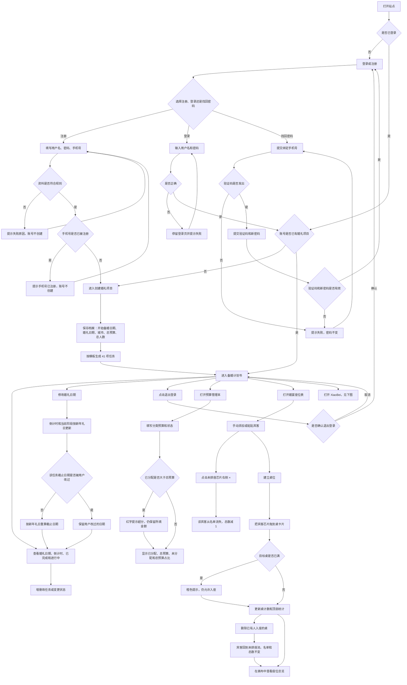

婚礼档案照片（REQ-017，AC-090 至 AC-095）。建项不经过这张图。

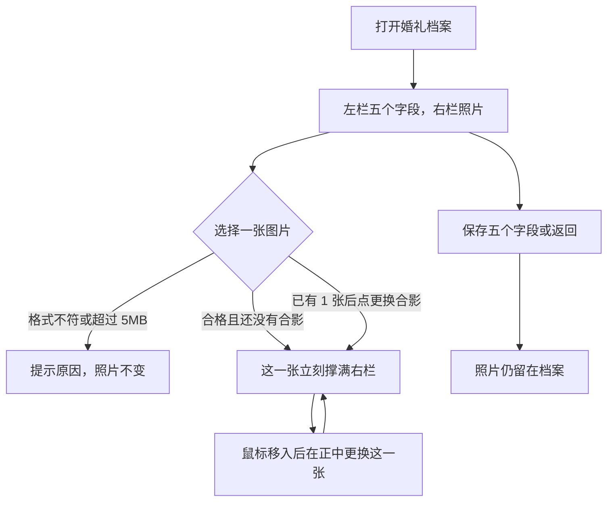

### 核心交互时序图

参与者为用户、前端、后端、SQLite，以及找回密码时的短信通道（开发 Mock / 生产阿里云号码认证 SendSmsVerifyCode）。同步返回。关键失败见各图 `alt`。登录页显示或隐藏密码只发生在前端：不调用 API-002，也不改变随后提交的密码。

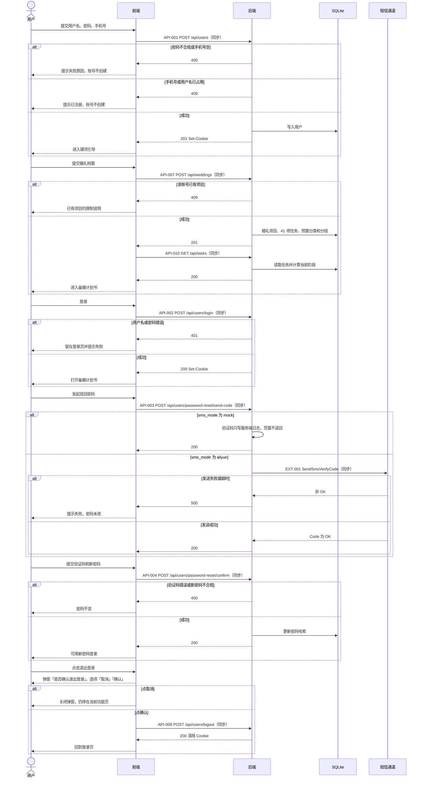

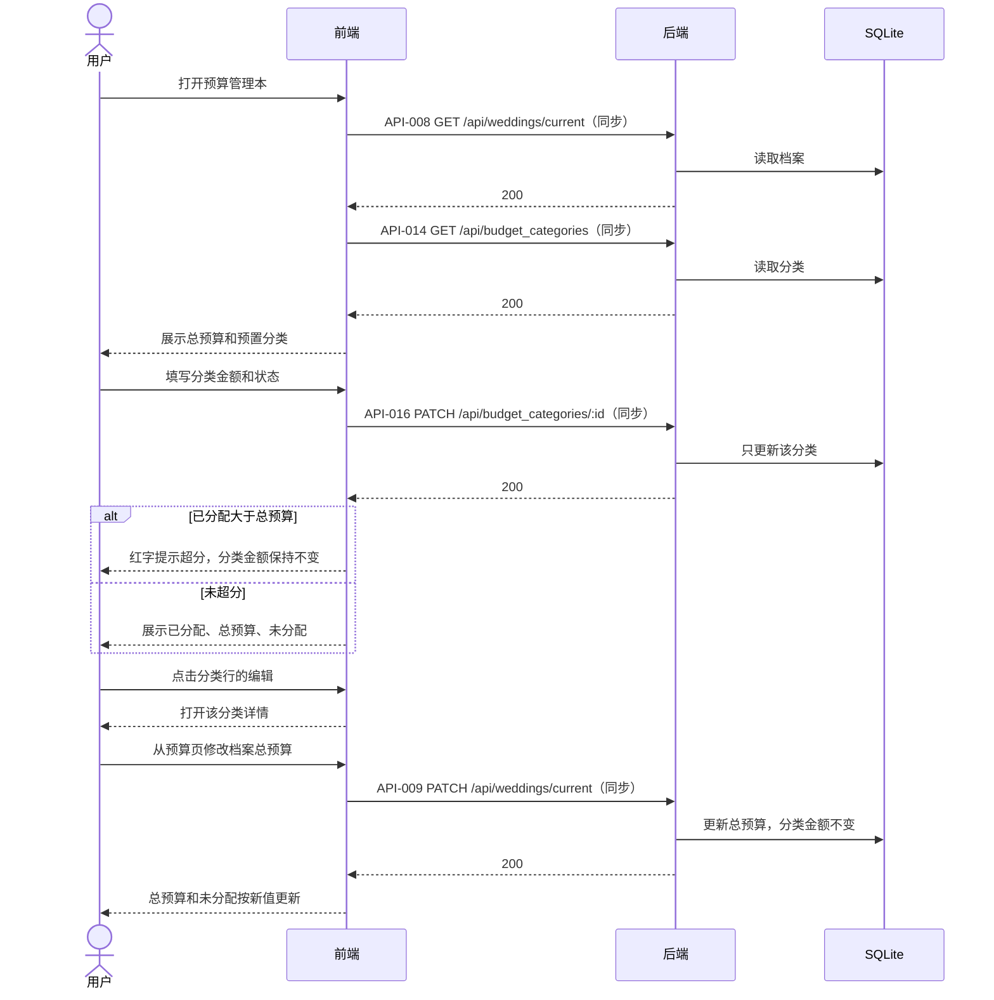

婚礼档案照片（REQ-017，AC-090 至 AC-095）。每个项目只有 1 张。鼠标移到合影上才在正中显示「更换合影」，更换是对这一张再传一次合格图片，失败时这一张保持原图。保存五个字段仍走 API-009，不携带照片。

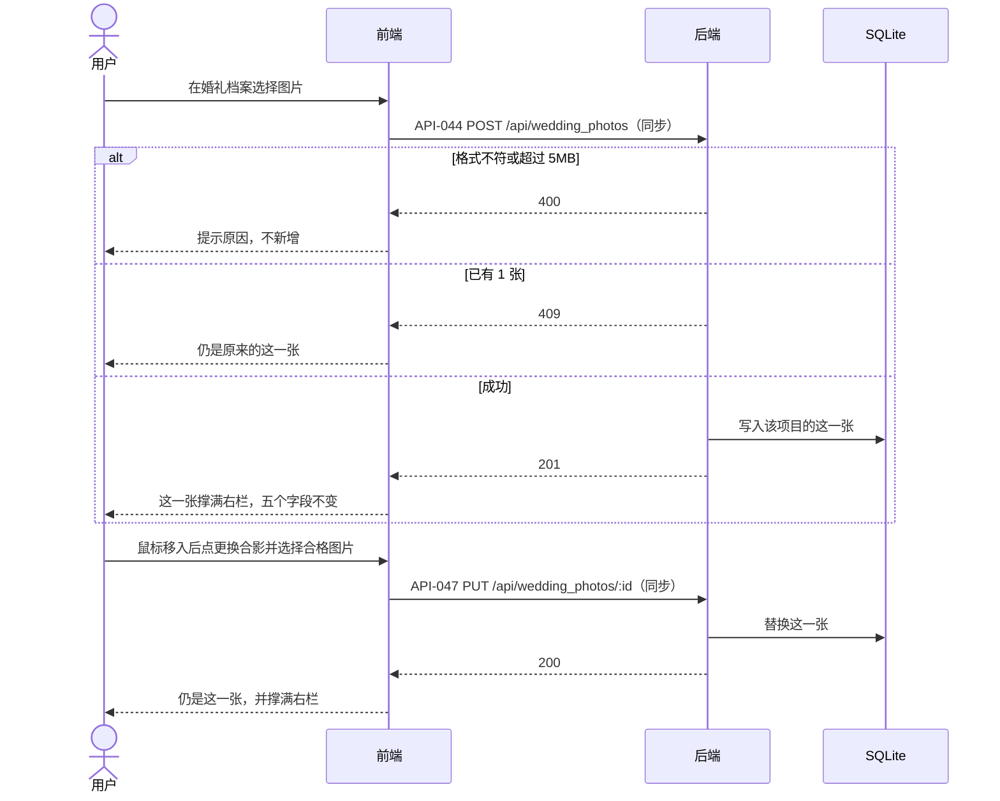

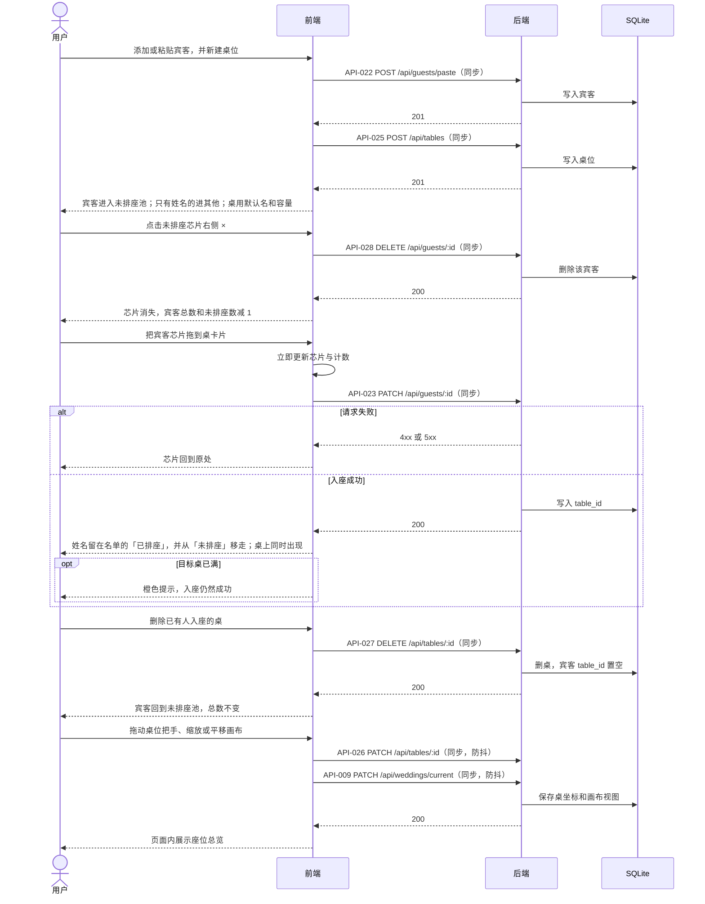

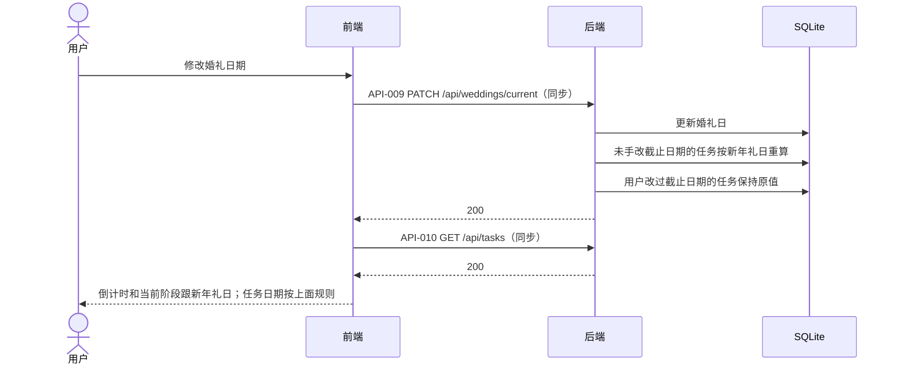

### XiaoBei 问答流程图

覆盖 REQ-012、REQ-014、REQ-015、REQ-016。登录后的第一屏仍是备婚计划书。空白不能发送、文字过长、图片超过 5MB、图片无法识别、从上传图片选择的非图片文件、不是 md 的上传文件、当前是 Pro 时加图片、超出范围、超时、请求过多和其他失败都会改变用户看到的结果。

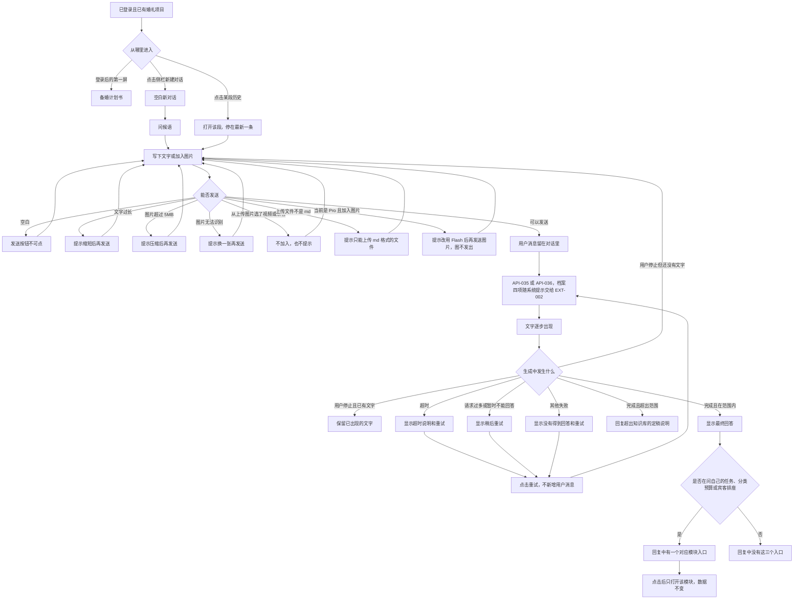

### XiaoBei 历史流程图

覆盖 REQ-013。删除前的确认会改变这段对话是否消失。

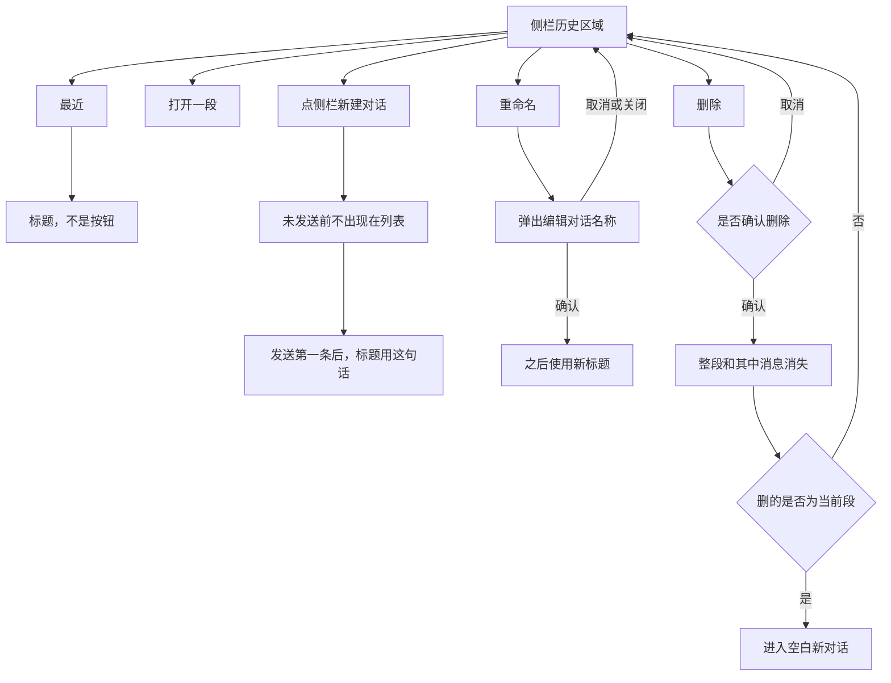

### XiaoBei 交互时序图

参与者为用户、前端、后端、存储和 Deepseek。备备附带的只有婚礼日期、城市、总预算和总人数。任务、预算分类、宾客和座位不附带。失败时使用 AC-084 至 AC-086 的对应原句。回复不修改计划书、预算本、座位表和婚礼档案。流式接口为 API-035 / API-036 / API-038；列表与跨页同步为 API-029、API-042。

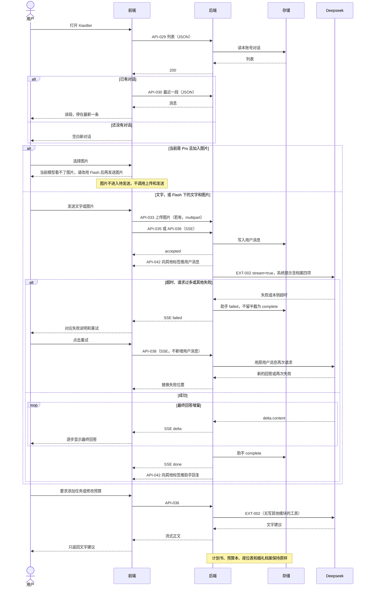

个人中心（REQ-018，AC-099 至 AC-102）。本次没有已设置头像的分支。

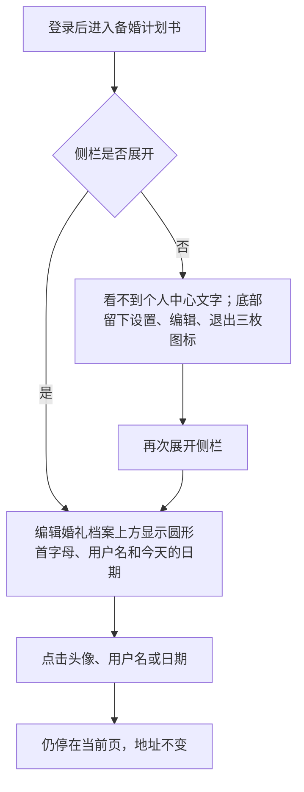

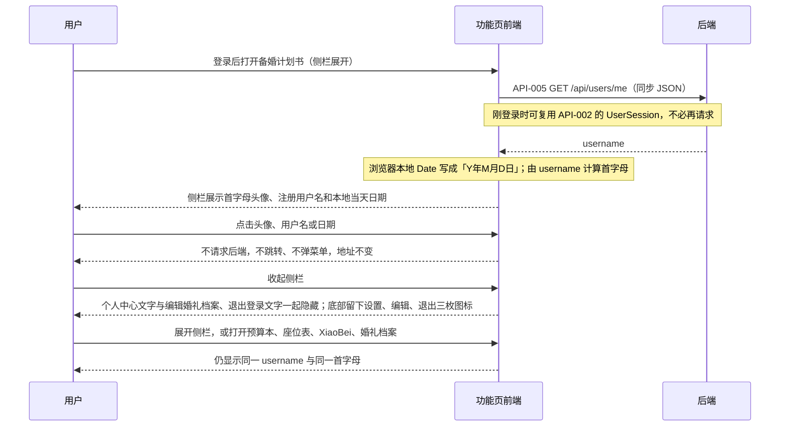

## 界面约定

1.0 是 PC 网页，按桌面浏览器使用。视觉取值见 [ui-style.md](ui-style.md)，可操作原型见 [prototypes/index.html](prototypes/index.html)。本文只定页面、关键文案和业务状态。

功能页为左侧模块入口加右侧内容区。侧栏顶部是产品标志和加粗的「备备」，右上角可折叠。展开时模块顺序为新建对话、备婚计划书、预算管理本、婚宴座位表，其下是历史区域，再往下是个人中心、「编辑婚礼档案」和「退出登录」。个人中心不写标题：左侧是正圆、无边框、玫瑰粉底、白色字的首字母，右侧上方是注册用户名，下方是今天的日期，这一行最右侧是设置图标。点击这四处没有反应。折叠后留产品标志、四个模块入口，以及底部的设置、编辑、退出三枚图标；不显示历史区域、个人中心，也不显示「编辑婚礼档案」和「退出登录」的文字，右侧内容区变宽。四个模块同一时刻只显示当前页。未登录只能打开登录、注册和找回密码。已登录但还没有婚礼项目时，只能走创建婚礼项目。刷新后地址、侧栏高亮和内容保持一致。同一页面里折叠、改状态、编辑、删除、新增等操作重画后，内容区、左侧名单和弹窗列表停在原来的滚动位置。换到计划书、预算本、座位表或档案页时从顶部开始。进入 XiaoBei、刷新 XiaoBei 或切换对话时停在该段最新一条。标志的样子见 [ui-style.md](ui-style.md)。XiaoBei 收起后的模块标志留到界面设计，对话里不使用头像。

| 页面 | 地址 | 原型 | 关键内容与状态 |
| --- | --- | --- | --- |
| 登录 | `/login` | [打开](prototypes/index.html#/login) | 页面背景是浅灰上整齐重复的玫瑰粉马赛克桃心，没有灰白方块。卡片顶部居中是产品标志和「备备」，「备备」为 28px、加粗。其下为用户名、密码（默认圆点）、「记住用户名和密码」、主按钮「登录」。密码框右侧可在明文和圆点之间切换，不提交登录。失败文案「用户名或密码不正确」。成功后有项目进入计划书，无项目进入建项。每次打开本页密码恢复为隐藏。 |
| 注册 | `/register` | [打开](prototypes/index.html#/register) | 背景与登录相同，为浅灰上的玫瑰粉马赛克桃心。用户名、密码、手机号，主按钮「注册」。密码不合规或手机号已注册时停在本页并说明原因，已填内容保留。 |
| 找回密码 | `/reset-password` | [打开](prototypes/index.html#/reset-password) | 手机号、「获取验证码」、验证码、新密码，主按钮「重置密码」。验证码不出现在页面上。成功后进入登录页，不自动登录。 |
| 创建婚礼项目 | `/wedding/new` | [打开](prototypes/index.html#/wedding/new) | 开始备婚日期、婚礼日期、城市、总预算、总人数，主按钮「创建项目」。已有项目时不再给出空表单，提示「你已经有一个婚礼项目」。 |
| 婚礼档案 | `/wedding` | [打开](prototypes/index.html#/wedding?from=plan) | 从侧栏「编辑婚礼档案」打开。不离开当前模块：侧栏高亮保持来源页，档案从内容区右侧向左抽出并盖住内容区，不盖住侧栏。再点一次「编辑婚礼档案」收回。标题「婚礼档案」同一行右上方是「返回」，与标题垂直居中。其下左右两栏。左栏没有栏标题。第一排是新郎昵称和新郎生日，第二排是新娘昵称和新娘生日，其下是五个字段，最下方是「其他婚礼偏好」，输入框预留四行。「保存」在栏内右下角。整份档案留在一屏内，左栏不出现滚动条。两栏下边框与「退出登录」的下缘齐平。右栏是「上传婚纱照/新人合照」；没有照片时右栏边框为宽 3、高 4，上传入口在栏内居中。有照片时这一张撑满右栏，不再显示「上传婚纱照/新人合照」。鼠标移到合影上，正中才出现「更换合影」。上传和更换立即生效，不必点「保存」。只有 1 张。点「返回」、再点一次侧栏按钮，或保存成功后，抽屉向右收回并回来源页。预算页没有单独的改总预算按钮。从预算打开时总预算字段聚焦。照片仍留在档案。 |
| 备婚计划书 | `/plan` | [打开](prototypes/index.html#/plan) | 展板最前是婚礼日期，上方「婚礼日期」、下方如「2026/9/12」，排版与倒计时相同。其后是倒计时、已完成数 / 任务总数、进行中数 / 任务总数、按阶段折叠的任务。阶段按用户保存的顺序排列，当前阶段默认展开但不排到最前。阶段标题行从左到右是白底粉字、字重 700 的 STAGE-0N 标签、【名称】、编辑、删除、下拉箭头。点击标题、序号标签或箭头时，任务区高度平滑收起或展开。编辑只改【】里的名称，序号自动按顺序重写。第一组阶段上方的右上角是粉底白字的「新增阶段」，位置与预算页「新增预算」相同。删除前确认，确认后该阶段和其中的任务一起消失。在标题上按住超过 0.5 秒可拖动整组阶段。没有「今日待办」和「逾期任务」。任务行最前是一枚直径 5px 的圆点，其后为事项名称、「截止日期」加日期、备注、状态、编辑和删除。没有备注时留空。点「编辑」只改任务名称，没有阶段字段。点日期标签打开日期选择器，标签右侧有下拉箭头。状态在第四列直接修改，有未开始、进行中、已完成、已超期。已超期为正红 `#FF0000` 底白字，不计入已完成或进行中。截止日期早于今天且不是已完成时，自动变为已超期。删除前确认。在任务行按住超过 0.5 秒后可拖到任意阶段的任意位置。 |
| 预算管理本 | `/budget` | [打开](prototypes/index.html#/budget) | 总预算、已分配、未分配、分类列表。页面没有饼图或环形图。超分时未分配用红字并写「已超出总预算」。分类行从左到右是色块、预算名称、预算金额、总预算占比、预算备注、预算状态、编辑、删除，不展示字段名称。总预算占比等于该项金额除以总预算，保留两位小数，显示为宽 100px 的粉底白字标签，百分比为 14px 并在方块内居中。金额右对齐、14px，在行内竖直居中。金额和占比靠近分类名称。预算备注在占比和状态之间。备注条左缘在右移 30px 的位置上再向左移 50px，右缘仍与预算状态相距 30px，各行「备注：」左缘对齐。底色为浅粉，文字为粉红色。有内容时显示「备注：」加备注，没有备注时显示「备注：暂无」。点击行本身不进入编辑；点「编辑」才进入金额、状态和预算备注。在名称、金额、占比、备注、状态或空白处按住超过 0.5 秒可拖动换位置，样式与计划书任务拖动相同；未满 0.5 秒不移动。按住编辑或删除不会开始拖动。点「删除」后该分类消失。金额为 0.00 时第一次点击金额框会清空。详情里的主按钮是「保存」。保存成功后该条收起；金额不合法时仍展开并提示。没有记支出的入口。分类列表右上角是粉底白字的「新增预算」，左侧同一行是「* 温馨提示：点击长按拖动可调换预算位置哦~」，14px、Accent，与按钮垂直居中对齐。旁边没有名称输入框。点击后弹窗填写预算名称、预算金额、预算状态、预算备注。备注可空。状态为未确定、已确定、已支付，默认未确定。未确定灰底灰字，已确定绿底白字，已支付蓝底白字。 |
| 婚宴座位表 | `/seating` | [打开](prototypes/index.html#/seating) | 宾客总数、已确认、已排座、未排座；左侧有「添加宾客」「全部宾客名单」和「已排座」「未排座」。添加弹窗填写姓名、分组、出席，最下方是宾客序号，留空为 0。全部宾客名单第一列是宾客序号，其后为姓名、分组和出席，四列居中。已排座、未排座、每张桌上和全部宾客名单里的姓名都按宾客序号从小到大排列，序号相同则保持原有先后。出席是标签，只能在编辑里改。每行最右侧可编辑或删除。入座后姓名留在「已排座」。已排座和桌上的姓名使用同一种颜色，未排座为深灰底白字，都不按分组区分。芯片右侧「×」删除该宾客。 |
| 新建对话 | `/xiaobei` | [打开](prototypes/index.html#/xiaobei) | 内容区只有当前对话。空白时显示「备备能帮您做什么？」，没有引导问题，输入框与问候在一起。有消息后输入框固定在底部，下方为「回答仅供备婚参考，具体以商家合同和当地习俗为准。」输入框旁是当前 Deepseek 模型和加入图片的入口。当前是 Pro 时加入图片不进入待发送，并显示「当前模型看不了图片，请改用 Flash 后再发送图片。」用户消息在右、浅灰圆角气泡；备备在左，无名字、无头像、无时间。失败时该位置显示对应说明和「重试」。点历史「重命名」弹出「编辑对话名称」，不在列表行内改名。 |

关键共用文案：主保存动作在等待时显示「正在保存」。退出登录前弹窗文案为「是否确认退出登录」，选项为「取消」和「确认」。确认后回到登录页。

## 待确认事项

无未决产品事项。2026-10-04 用户确认对话区按元宝：用户浅灰圆角气泡、助手无署名、图标工具、长消息展开、离开底部可回到最新。见 AC-071。2026-10-04 用户要求产品 AI 不再叫 XiaoBei，改称备备；侧栏第一项为「新建对话」，问候为「备备能帮您做什么？」。2026-10-04 随 1.0 原型一并确认。见 AC-050、AC-052、AC-068、AC-071。2026-10-04 用户要求改名弹窗去掉绿色对勾、输入框为三行高、用户改名最多 200 个字符；第一条用户消息作为标题时不受这 200 字限制。2026-10-04 随 1.0 原型一并确认。见 AC-054、AC-055。2026-10-04 用户要求点「重命名」后弹出「编辑对话名称」，不在列表行内改名，2026-10-04 随 1.0 原型一并确认。见 AC-055。2026-10-04 用户确认点侧栏 XiaoBei 进入空白新对话；历史区顶部为「最近」；改名和删除收入「…」菜单，仅鼠标停着的那一行显示「…」。见 AC-052、AC-053。2026-10-04 用户确认「上传文件」只接受 .md，由备备抽出文字再发送，不抽取 Word、Excel、PPT 和 PDF。见 AC-104。2026-10-03 用户确认点击「退出登录」先出现弹窗「是否确认退出登录」，选项为「取消」和「确认」。点取消仍停留，点确认才退出。见 AC-103。2026-10-03 用户确认 REQ-018、AC-099 至 AC-102：侧栏个人中心只展示头像首字母、注册用户名和本地当天日期，位置在「编辑婚礼档案」上方。默认头像为正圆、无边框、玫瑰粉底、白色字。没有上传头像，也不能点击。2026-10-02 用户确认 REQ-012 至 REQ-016、AC-050 至 AC-086 的写入文字，PRD 标为 Confirmed。同日确认 D-005-B、D-006-A，对应 AC-087；关闭思考不新增页面文案。单条文字上限 4000 码点、Deepseek 可选模型名单和默认模型见技术方案，不改变已写明的失败文案和「只显示最终回答」。2026-10-03 用户确认 REQ-017、AC-090 至 AC-095：婚礼档案照片单独保存，只有 1 张并撑满右栏，鼠标移入才在正中显示「更换合影」，建项页不加。同日确认「返回」在标题行右上方并与「婚礼档案」垂直居中，侧栏「编辑婚礼档案」点一次抽出、再点一次收回，见 AC-090、AC-096。同日确认左栏去掉栏标题，「保存」在栏内右下角；上传入口居中；照片固定为宽 3、高 4。两栏下边框与「退出登录」下缘齐平，未上传时右栏边框为宽 3、高 4。同日确认婚礼档案第一排为新郎昵称和新郎生日，第二排为新娘昵称和新娘生日，生日用日历选择，见 AC-097。建项页不加。同日确认总人数下方增加「其他婚礼偏好」，输入框预留四行，整份档案留在一屏内、左栏不出现滚动条，见 AC-098。建项页不加。

2026-10-01 已确认：

1. 1.0 只做 PC 端，不做移动端布局和移动端排座。
2. 建议截止日期按阶段窗口结束日回推，规则见 REQ-005。
3. 当前阶段边界见 REQ-005。
4. 批量粘贴时只有姓名的宾客，分组为「其他」。

2026-10-02 已确认（用户原话「全部按建议」）：

5. 修改婚礼日期后，未手改过截止日期的任务按新年礼日重算，用户改过的保留；倒计时和当前阶段跟新年礼日。见 AC-041。
6. 删除已有人入座的桌时，宾客回到未排座池，名单保留，宾客总数不变。见 AC-042。
7. 手机号全站唯一，重复手机号不能再注册。开发默认不真实发短信，生产用阿里云短信。见 AC-043。
8. 功能页提供退出登录。点击后先确认，确认后访问计划书需要重新登录，30 天登录态被清除；取消则仍停留。见 AC-044、AC-103。

2026-10-02 已确认（用户确认按文档修改原型）：

9. 登录页密码框右侧可在明文和圆点之间切换。默认圆点；不改变已输入字符，也不提交登录；再次打开登录页恢复隐藏。注册页和找回密码页不加。见 AC-045、AC-046。

2026-10-02 已确认（用户指定删除座位表添加宾客的备注框）：

10. 婚宴座位表添加宾客时只填姓名、分组和出席，没有备注框。预算分类仍可写备注。见 REQ-008、AC-028。

2026-10-02 已确认（用户指定未排座宾客可删除）：

11. 未排座池中宾客芯片右侧有「×」。点击后该宾客从名单删除，总数减少。桌内「×」仍只是回到未排座。见 AC-047。

2026-10-02 已确认（用户指定名单分区）：

12. 左侧宾客名单分为「已排座」和「未排座」。拖到桌上后姓名从「未排座」移到「已排座」，不从名单消失。见 AC-031。

2026-10-02 已确认（用户指定添加宾客改为弹窗）：

13. 左侧栏只保留「已排座」「未排座」，以及「添加宾客」按钮。点击后弹窗填写姓名和选择分组。出席、粘贴名单、搜索和分组筛选暂不展示。见 AC-026、AC-027。

2026-10-02 已确认（用户指定全部宾客名单，并加回出席）：

14. 左侧增加「全部宾客名单」。弹窗以列表展示全部宾客的姓名、分组和出席，出席可在列表中修改。添加宾客弹窗同时包含出席。见 AC-026、AC-028。

2026-10-02 已确认（用户指定缩小名单弹窗，并增加备注、搜索和筛选）：

15. 全部宾客名单弹窗缩小为原先的三分之二。列表为姓名、宾客类型、出席状态、备注四列，标题放大。备注可在该列表中修改。上方可按姓名搜索，并可按宾客类型和出席状态筛选。

2026-10-02 已确认（用户指定名单弹窗加高，搜索改为按钮触发）：

16. 全部宾客名单弹窗宽度不变，高度在当前基础上增加四分之一。搜索框与两个筛选框等宽，右侧为「重置」和「搜索」。点「搜索」后姓名、宾客类型、出席状态一起生效；点「重置」清空条件并显示全部。

2026-10-02 已确认（用户指定修复分组选择，并重排宾客类型）：

17. 添加宾客弹窗里可以切换分组，选中后保持。预置宾客类型为新郎、新娘、男方亲属、女方亲属、男方朋友、女方朋友、男方同事、女方同事。已有宾客的原分组不变。

2026-10-02 已确认（用户指定计划书展板最前增加婚礼日期）：

16. 备婚计划书顶部展板最前一格显示婚礼日期，上方「婚礼日期」、下方「2026/9/12」，排版与倒计时相同，月和日不补零，日期来自婚礼档案。见 AC-016。

2026-10-02 已确认（用户指定计划书任务可长按拖动）：

18. 在任务条目上按住超过 0.5 秒后，可以把该任务拖到任意阶段的任意位置。未满 0.5 秒松手则不动。名称、状态和截止日期不因拖动改变。见 AC-048。

2026-10-02 已确认（用户指定名单去掉备注，并在每行增加编辑和删除）：

19. 全部宾客名单不再展示备注。每行最右侧有「编辑」和「删除」。编辑可改姓名、分组和出席；删除后该宾客从名单消失。见 REQ-008。

2026-10-02 已确认（用户指定出席改为标签，且只能在编辑里修改）：

20. 全部宾客名单里的出席是标签。待定灰底白字，已确认绿底白字，已婉拒红底白字。不打开编辑就不能改出席。

2026-10-02 已确认（用户指定每个阶段各自新增任务）：

22. 备婚计划书顶部不再放统一的「新增任务」。每个阶段展开后，标题下方有自己的「新增任务」，新任务属于该阶段并出现在该阶段最前。见 AC-013。

2026-10-02 已确认（用户指定计划书阶段标题）：

21. 五个阶段标题依次为「STAGE-01【备婚启动期】」「STAGE-02【正式筹备期】」「STAGE-03【婚前冲刺期】」「STAGE-04【婚礼月】」「STAGE-05【婚礼周】」，字号 16px。见 REQ-005。

2026-10-02 已确认（用户指定宾客序号、居中和排序）：

22. 全部宾客名单的宾客序号、姓名、宾客类型、出席状态，表头和内容都居中。新增宾客序号，添加弹窗最下方可填，留空为 0。名单第一列是宾客序号，在姓名之前。已排座、未排座、每张桌上和全部宾客名单里的姓名都按宾客序号从小到大排列，序号相同则保持原有先后。见 AC-049。

2026-10-02 已确认（用户指定姓名顺序与宾客序号一致）：

25. 座位表里凡是展示姓名的地方，顺序都跟宾客序号一致：已排座、未排座、每张桌上、全部宾客名单。序号相同则保持原有先后。改序号后这几处一起变。见 AC-049。

2026-10-02 已确认（用户指定宾客名称统一颜色）：

24. 婚宴座位表的宾客名称不再按类型区分颜色。已排座和桌上的姓名使用同一种颜色，未排座为深灰底白字。见 AC-035。

2026-10-02 已确认（用户指定操作后不要弹回顶部）：

23. 备婚计划书、预算管理本、婚宴座位表以及其余页面，在当前页操作后保持滚动位置，不再回到顶部。换页时从顶部开始。

2026-10-02 已确认（用户指定阶段展开折叠更顺）：

24. 点击阶段标题时，该阶段的任务区用高度变化展开或收起，过程连续，不再整段瞬间切换。拖动任务落到折叠阶段时仍立即展开，以便选择位置。

2026-10-02 已确认（用户指定预算预置分类）：

26. 预算管理本默认展示 17 个分类，顺序为婚礼场地费、婚宴餐费、策划设计费、四大-摄影师费、四大-摄像师费、四大-主持人费、四大-化妆师费、甜品台费、现场布置费、新娘婚纱费、新娘婚鞋费、新郎西服费、新郎皮鞋费、宾客伴手礼费、宾客邀请函费、烟/酒/茶/喜糖费、宾客住宿费。见 AC-019。

2026-10-02 已确认（用户指定分类保存后收起）：

27. 分类详情的主按钮文案为「保存」。保存成功后该条自动收起，不再保持展开。金额不合法时仍展开并提示。

2026-10-02 已确认（用户指定去掉分类备注，并在首次点击时清空 0.00）：

28. 预算分类详情没有备注。金额为 0.00 时，第一次点击金额框会清空。已有非 0 金额时，点击不会清空。

2026-10-02 已确认（用户指定分类行字段顺序，以及编辑、删除按钮）：

29. 分类行从左到右为色块、预算名称、预算金额、预算状态、编辑、删除。点击行本身不进入编辑，点「编辑」才进入。点「删除」后该分类消失。

2026-10-02 已确认（用户指定不展示分类字段名称）：

30. 预算分类列表不展示「色块」「预算名称」「预算金额」「预算状态」「编辑」「删除」这些字段名称。

2026-10-02 已确认（用户指定图例默认两列）：

31. 预算环形图下的分类图例默认分两列，按分类顺序先排左列，再排右列。

2026-10-02 已确认（用户指定新增预算改为弹窗）：

32. 分类列表上方去掉名称输入框。「新增预算」为粉底白字，点击后弹窗填写预算名称、预算金额、预算状态。

2026-10-02 已确认（用户指定预算状态与任务状态同色）：

33. 预算状态为未确定、已确定、已支付，默认未确定。未确定灰底灰字，已确定绿底白字，已支付蓝底白字，与计划书任务状态同一套。原先的「规划中」改为未确定，「已定」改为已确定。

2026-10-02 已确认（用户指定取消饼图，并在金额后显示总预算占比）：

34. 预算页不展示饼图或环形图。分类行在预算金额后显示总预算占比，等于该项金额除以总预算，保留两位小数。

2026-10-02 已确认（用户指定金额与占比靠近名称，占比改为标签）：

35. 预算金额和总预算占比靠近分类名称。总预算占比显示为粉底白字标签。

2026-10-02 已确认（用户指定新增预算备注）：

36. 分类行在总预算占比和状态之间显示预算备注，可空。新增预算弹窗包含预算备注。点「编辑」也可改备注。

2026-10-02 已确认（用户指定预算分类可长按拖动）：

37. 预算分类按住超过 0.5 秒后可拖动换位置，交互和样式与备婚计划书任务拖动一致。未满 0.5 秒不移动。名称、金额、状态、备注和色块不因拖动改变。见 AC-088。

2026-10-02 已确认（用户原话「1）B」「2）A」）：

28. Flash 与 Pro 都可选。当前是 Flash 时发图照常。当前是 Pro 时不能把图片加入待发送，提示「当前模型看不了图片，请改用 Flash 后再发送图片。」不自动改用 Flash。调用 Deepseek 时关闭思考，页面仍只显示最终回答。见 AC-087。

2026-10-03 已确认（用户指定阶段可增删改并长按排序）：

38. 阶段标题行从左到右是 STAGE-0N【名称】、编辑、删除、下拉箭头。序号按顺序自动更新，不能手改。编辑只改【】里的名称，空名称不保存。删除沿用「您是否确认删除？」，确认后阶段和其中任务一起删除。列表最下方「新增阶段」，新阶段在最后，名称为「新阶段」，展开并进入编辑。按住标题超过 0.5 秒拖动整组，样式与任务拖动相同。没有置顶，顺序完全按用户的调整。五个默认阶段同样可以改名、删除和拖动。见 AC-089。

2026-10-03 已确认（用户指定序号改为标签，新增阶段改到展板右上角）：

39. 阶段序号 STAGE-0N 单独做成白底粉字标签，和后面的【名称】分开。展板右上角放「新增阶段」，点击后仍在列表最后新增，立刻展开并进入编辑。见 AC-089。

2026-10-03 已确认（用户指定新增阶段在展板下方、STAGE-01 上方右上角）：

40. 「新增阶段」不压在展板上。它在展板下方、第一组阶段上方，靠右。点击后仍在列表最后新增，立刻展开并进入编辑。见 AC-089。

2026-10-03 已确认（用户指定新增阶段与新增预算同位置、同为粉底白字）：

41. 「新增阶段」与预算页「新增预算」在页面上同一位置：展板下方、列表上方，靠右。按钮为粉底白字。点击后仍在列表最后新增，立刻展开并进入编辑。见 AC-089。

2026-10-03 已确认（用户指定永远留出滑动条位置）：

42. 计划书和预算本的内容区始终留出竖向滚动条的位置。阶段展开或分类变多时，粉条和列表宽度不变。见界面风格。

2026-10-03 已确认（用户指定阶段序号加粗）：

43. 阶段序号标签里的 STAGE-0N 为字重 700。阶段名称仍是 16px、字重 400。见 AC-089。

2026-10-03 已确认（用户指定计划书温馨提示）：

44. 展板下方、第一组阶段上方，左侧显示「* 温馨提示：点击长按拖动可调换阶段/任务位置哦~」，14px、Accent，与右侧「新增阶段」垂直居中对齐。见界面风格。

2026-10-03 已确认（用户指定预算本温馨提示）：

45. 预算页与计划书温馨提示同一位置：列表上方左侧，与右侧「新增预算」垂直居中对齐。文案为「* 温馨提示：点击长按拖动可调换预算位置哦~」，14px、Accent。见界面风格。

2026-10-03 已确认（用户指定任务增加已过期）：

46. 计划书任务状态增加「已过期」，下拉选项为未开始、进行中、已完成、已过期。已过期为正红 `#FF0000` 底白字。不计入展板的已完成或进行中。预算状态不加这一项。

2026-10-03 已确认（用户指定已过期改称已超期，并在截止日期过后自动变更）：

47. 「已过期」改称「已超期」。用户仍可在状态下拉里手动选择。任务上用户设置的截止日期早于今天、且状态不是已完成时，自动变为已超期。已完成过了截止日期仍保持已完成。见界面风格。

2026-10-03 已确认（用户指定预算备注展示前缀）：

48. 预算分类列表的备注前加「备注：」。没有填写备注时显示「备注：暂无」。填写后显示「备注：」加所填内容。保存时备注仍可空。见界面风格。

2026-10-03 已确认（用户指定备注列与占比拉开并对齐）：

49. 预算备注列放在占比和状态之间，与占比拉开固定空隙。每一行「备注：」的左缘对齐。见界面风格。

2026-10-03 已确认（用户指定备注条再右移，并改为浅粉底粉字）：

50. 预算备注条在上一版位置上再向右移 30px，右缘与预算状态保持 30px。底色为浅粉，文字为粉红色。各行「备注：」左缘仍对齐。见界面风格。

2026-10-03 已确认（用户指定备注条左缘再向左移，右缘不动）：

51. 预算备注条左缘在上一版基础上再向左移 50px。右缘与预算状态仍保持 30px。各行「备注：」左缘仍对齐。见界面风格。

2026-10-03 已确认（用户指定预算金额字号与占比方块宽度）：

52. 分类行的预算金额为 14px，在行内竖直居中。总预算占比的背景方块宽 100px，百分比为 14px 并在方块内居中。见界面风格。

2026-10-03 已确认（用户同意档案页两栏和照片单独保存）：

39. 婚礼档案在五个字段右侧展示 1 张新人合影，由用户手动上传。没有照片时只有上传入口。上传后这一张撑满右栏宽 3、高 4 的框。鼠标移到合影上，正中才出现「更换合影」。上传和更换立即生效。只接受 JPEG、PNG、GIF、WebP，单张不超过 5MB。创建婚礼项目不加这一栏。照片不进入 XiaoBei，也不出现在计划书、预算本和座位表。见 REQ-017、AC-090 至 AC-095。
